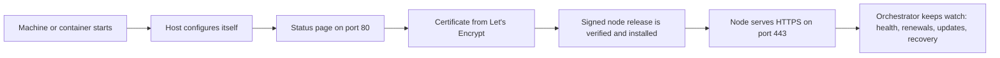

# FortisNet Node OS

The operating system for FortisNet nodes: a minimal Alpine-based image with
an orchestrator that installs, updates and recovers the node. Also available
as a container image.

Create a server from the image and it becomes a working FortisNet node by
itself. It finds its address, obtains an HTTPS certificate from Let's
Encrypt, installs the node and shows a status page. Nobody logs in, and
nothing is typed.

[](https://github.com/FortisNet/node-os/actions/workflows/build.yml)
[](LICENSE)

> **Status: early.** The images work end to end and are tested, but there is
> no numbered release yet, and the node inside runs in development mode.
> Expect changes. See [What is not done yet](#what-is-not-done-yet).

## What you get

One build produces three images from the same sources. Each is named after
the commit it was built from.

| Image | Use it for |
| --- | --- |
| **Disk image**, x86-64 (`.qcow2`) | A new virtual machine on a cloud. The main way to run a node: the machine is dedicated to it |
| **Container image**, x86-64 | A server that already runs Docker, with an Intel or AMD processor |
| **Container image**, ARM64 | A server that already runs Docker, with an ARM processor |

Inside each: stock [Alpine Linux](https://alpinelinux.org) with the packages
a node host does not need taken out, the **orchestrator** (one small C++
program), one signed **node release**, and the public key future releases
must be signed with. The disk image adds a firewall that leaves only ports
22, 80 and 443 reachable. [image/README.md](image/README.md) lists every
package and file, with the reason it is there.

## Quick start

Images are built by this repository's pipeline and published on the
[releases page](https://github.com/FortisNet/node-os/releases): numbered
releases, and **edge**, rebuilt from every commit on `main`. The container
images are also at `ghcr.io/fortisnet/node-os`.
[docs/releasing.md](docs/releasing.md) shows how to check a download. You
can also [build them yourself](#building).

> Until a signed node release is pinned for the pipeline, the published
> builds hold the orchestrator only, and images are built locally.

### On a cloud, from the disk image

1. Upload `fortis-node-os-x86_64-COMMIT.qcow2` as a custom image. On
   DigitalOcean: **Images**, **Custom Images**, **Upload**; for the
   distribution choose the generic entry ("Unknown" or "Other").
2. Create a virtual machine from it, with your SSH key.
3. Open `http://ADDRESS/`. The page says what the host is waiting for. After
   a minute or two `https://ADDRESS/` answers with a trusted certificate and
   the node behind it.

### On a server with Docker

```sh
docker run -d --name fortis-node --restart unless-stopped \
  --privileged --init --stop-timeout 240 \
  -p 80:80 -p 443:443 \
  -v fortis-data:/var/lib/fortis \
  ghcr.io/fortisnet/node-os:edge
docker logs -f fortis-node
```

Docker picks the image for the server's processor, Intel/AMD or ARM.

The server must be reachable from the internet on ports 80 and 443. Each
option is explained in [image/README.md](image/README.md#the-container-packaging).

## What happens on first start



Each step is retried until it succeeds, and the status page says in one
sentence what the host is waiting for.
[docs/first-boot.md](docs/first-boot.md) follows every step to the file that
does it.

## How it is kept safe

- **Only signed releases run.** A host accepts a node release only when it
  is signed by the key built into its image. The store that releases are
  downloaded from is not trusted.
- **An update that fails is undone.** A new release is verified, tried and
  watched before it replaces the running one. The database is backed up
  first, and the previous release is started again if the new one does not
  hold.
- **The node has no privileges.** It runs in its own container as an
  ordinary user, with no capabilities, a read-only filesystem, memory and
  process limits and a system call filter. The orchestrator owns the public
  ports and hands them over already open.
- **Whatever talks to the network has no privileges either.** Certificate
  requests and downloads run as their own users; the administrator's side
  checks everything they bring back.
- **Small enough to read.** The orchestrator runs no other program except
  the container runtime `crun`: no shell, `curl` or package manager is in the
  path of an update. There is no container daemon and no remote management
  agent.
- **Hardened builds.** Static, position-independent programs; every source
  file's compiler flags are audited before a release is accepted.

To report a vulnerability, see [SECURITY.md](SECURITY.md).

## Operating a host

| To do this | On a machine | In a container |
| --- | --- | --- |
| Log in | `ssh alpine@ADDRESS`, key only | `docker exec -it fortis-node sh` |
| See health | `doas fortis status`, or open `/health` | `docker exec fortis-node fortis status` |
| Read the log | `doas tail -f /var/log/fortis-orchestrator.log` | `docker logs -f fortis-node` |
| List releases on offer | `doas fortis releases` | `docker exec fortis-node fortis releases` |
| Download and verify one | `doas fortis fetch VERSION` | `docker exec fortis-node fortis fetch VERSION` |
| Install it | `doas fortis update VERSION` | `docker exec fortis-node fortis update VERSION` |
| Back up the database | `doas fortis backup` | `docker exec fortis-node fortis backup` |

`/health.json` gives monitoring tools the same report as the health page and
answers 200 only when everything is healthy.

## Documentation

| | |
| --- | --- |
| [docs/first-boot.md](docs/first-boot.md) | From a new machine to a running node, step by step, and the settings you can give at creation |
| [docs/images.md](docs/images.md) | The three images, how a disk image differs from a container image, and why Docker cannot boot a disk |
| [docs/operating.md](docs/operating.md) | Reaching a host, its logs, the first page and the health report |
| [docs/releases.md](docs/releases.md) | Publishing node releases and how hosts fetch them |
| [docs/backup.md](docs/backup.md) | Backup and restore |
| [image/README.md](image/README.md) | Exactly what is in the images, and why |
| [docs/development.md](docs/development.md) | Layout of the code, the gate, release builds and the rules the design keeps |
| [docs/releasing.md](docs/releasing.md) | What the pipeline builds and publishes, how to check a download, and how a release is made |

## Building

You need Docker, Python 3 and `make`. Compilers and checkers run in
containers the build creates.

```sh
make verify                    # build, test and analyse everything; about three minutes
make release VERSION=1.2.3     # the orchestrator for x86-64 and ARM64, into dist/1.2.3/
./image/build-image.sh NODE_RELEASE RELEASE_PUBLIC_KEY dist/1.2.3     # the three images, into dist/image/
./image/test-container.sh fortis-node-os:COMMIT-aarch64               # try one end to end on this computer
```

`NODE_RELEASE` is a signed release of the FortisNet node and
`RELEASE_PUBLIC_KEY` the public half of the key that signed it.
[docs/development.md](docs/development.md) has the details.

## What is not done yet

- **A signed node release for the images.** Until one is pinned
  ([docs/releasing.md](docs/releasing.md#the-node-release-inside-the-images)),
  the pipeline publishes the orchestrator only and the images must be built
  locally. There is also no public store yet that hosts fetch node updates
  from.
- **Updating the system itself.** The node is updated by the orchestrator.
  The orchestrator and the Alpine base are not: today that means a new
  image.
- **Production mode for the node.** The image starts the node in development
  mode.
- **HTTPS before the node is up.** The status page is served over plain HTTP
  until the certificate is issued and the node runs.
- **Containers need `--privileged`.** A smaller set of rights has not been
  worked out.
- **ARM disk image.** ARM is a container image only.
- **The sandbox manager** in [sandbox/](sandbox) is not part of the images.

## Contributing

Changes are welcome. [CONTRIBUTING.md](CONTRIBUTING.md) explains how to
build, what the gate checks and what a change needs before it can be
merged. Please read the [code of conduct](CODE_OF_CONDUCT.md).

## License

[Apache License 2.0](LICENSE). Third-party notices are in [NOTICE](NOTICE).
