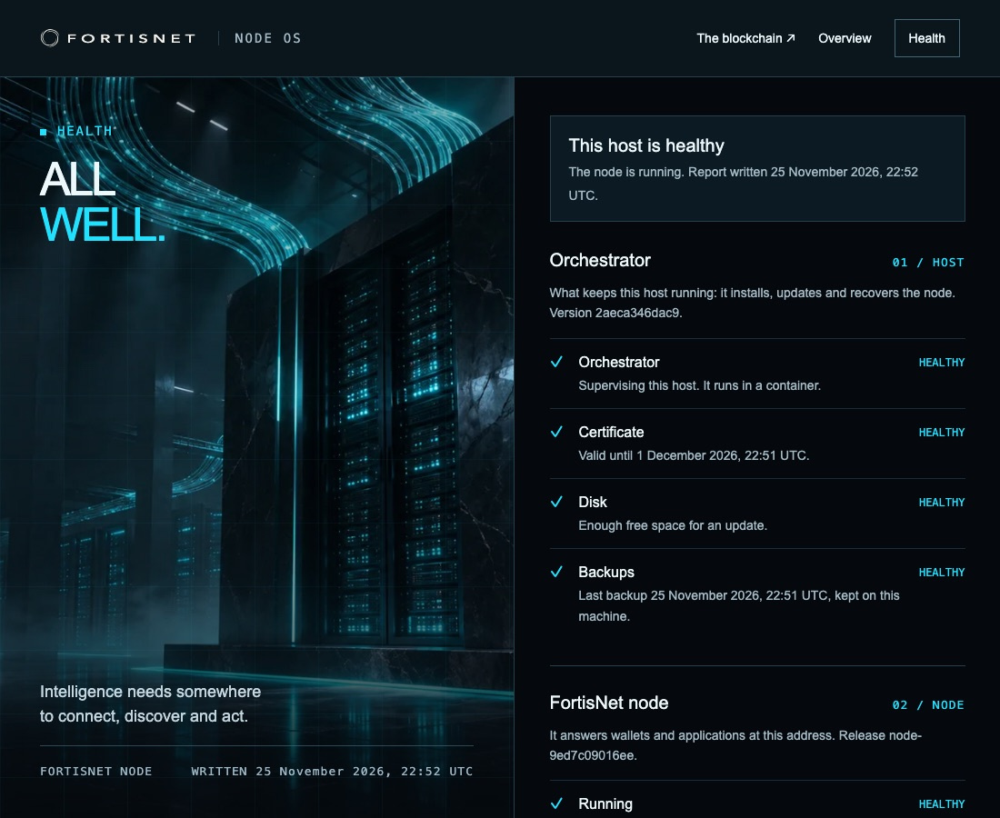
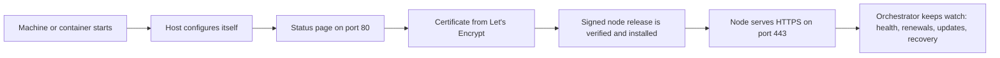
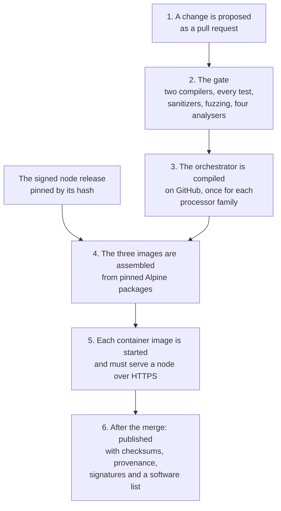
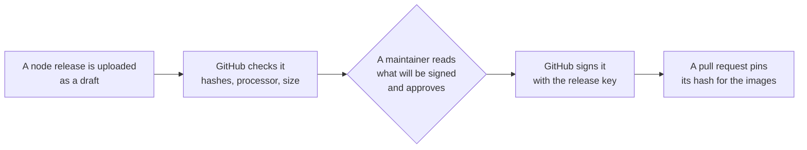

[](https://fortisnet.io)

> *People and AI agents will work across borders, services and networks.
> They need a shared foundation for identity, resources, value and
> verifiable results. FortisNet is building toward that foundation.*

# FortisNet Node OS

The operating system for FortisNet nodes: a minimal Alpine-based image with
an orchestrator that installs, updates and recovers the node. Also available
as a container image.

Create a server from the image and it becomes a working FortisNet node by
itself. It finds its address, obtains an HTTPS certificate from Let's
Encrypt, installs the node and shows a status page. Nobody logs in, and
nothing is typed.

[](https://github.com/FortisNet/node-os/actions/workflows/build.yml)
[](https://github.com/FortisNet/node-os/actions/workflows/codeql.yml)
[](https://scorecard.dev/viewer/?uri=github.com/FortisNet/node-os)
[](LICENSE)



> **Status: early.** The images work end to end and are tested, but this is
> a 0.x release and the node inside runs in development mode. Expect
> changes. See [What is not done yet](#what-is-not-done-yet).

## What you get

One build produces three images from the same sources. Each is named after
the commit it was built from.

| Image | Use it for |
| --- | --- |
| **Disk image**, x86-64 (`.qcow2`) | A new virtual machine on a cloud. The main way to run a node: the machine is dedicated to it |
| **Container image**, x86-64 | A server that already runs Docker, with an Intel or AMD processor |
| **Container image**, ARM64 | A server that already runs Docker, with an ARM processor |

The node itself, the program wallets and applications talk to, is developed
in [FortisNet/node](https://github.com/FortisNet/node). This repository is
everything around it.

Inside each: stock [Alpine Linux](https://alpinelinux.org) with the packages
a node host does not need taken out, the **orchestrator** (one small C++
program), one signed **node release**, and the public key future releases
must be signed with. The disk image adds a firewall that leaves only ports
22, 80 and 443 reachable. [image/README.md](image/README.md) lists every
package and file, with the reason it is there.

## Quick start

Images are built by this repository's pipeline and published on the
[releases page](https://github.com/FortisNet/node-os/releases): numbered
releases, and **edge**, rebuilt from every commit on `main`. The container
images are also at `ghcr.io/fortisnet/node-os`.
[docs/releasing.md](docs/releasing.md) shows how to check a download. You
can also [build them yourself](#building).

### On a cloud, from the disk image

1. Upload `fortis-node-os-x86_64-COMMIT.qcow2` as a custom image. On
   DigitalOcean: **Images**, **Custom Images**, **Upload**; for the
   distribution choose the generic entry ("Unknown" or "Other").
2. Create a virtual machine from it, with your SSH key.
3. Open `http://ADDRESS/`. The page says what the host is waiting for. After
   a minute or two `https://ADDRESS/` answers with a trusted certificate and
   the node behind it.

### On a server with Docker

```sh
docker run -d --name fortis-node --restart unless-stopped \
  --cap-add SYS_ADMIN --cap-add NET_ADMIN --cap-add SYS_PTRACE \
  --security-opt apparmor=unconfined --cgroupns private \
  --init --stop-timeout 240 \
  -p 80:80 -p 443:443 \
  -v fortis-data:/var/lib/fortis \
  ghcr.io/fortisnet/node-os:latest
docker logs -f fortis-node
```

Docker picks the image for the server's processor, Intel/AMD or ARM.

The server must be reachable from the internet on ports 80 and 443. Each
option is explained in [image/README.md](image/README.md#the-container-packaging).

### Where it has been tried

| Where | Image | How |
| --- | --- | --- |
| GitHub's x86-64 and ARM64 runners | Both container images | Automatically, on every build: first start to a node answering over HTTPS |
| A DigitalOcean Droplet with Docker | Container, x86-64 | By hand, with a certificate from Let's Encrypt's staging service |
| Docker Desktop on an Apple silicon Mac | Container, ARM64 | By hand |
| QEMU | Disk image | By hand: it boots and configures itself |

The disk image has not yet been started on a real cloud. If you try it on
one, please [tell us](https://github.com/FortisNet/node-os/issues) how it
went.

## What happens on first start



Each step is retried until it succeeds, and the status page says in one
sentence what the host is waiting for.
[docs/first-boot.md](docs/first-boot.md) follows every step to the file that
does it.

## How it is kept safe

- **Only signed releases run.** A host accepts a node release only when it
  is signed by the key built into its image. The store that releases are
  downloaded from is not trusted.
- **An update that fails is undone.** A new release is verified, tried and
  watched before it replaces the running one. The database is backed up
  first, and the previous release is started again if the new one does not
  hold.
- **The container is not privileged.** A container image asks Docker for
  three named rights, not for `--privileged`: it cannot reach the server's
  disks or devices, load kernel modules or set the clock.
- **The node has no privileges.** It runs in its own container as an
  ordinary user, with no capabilities, a read-only filesystem, memory and
  process limits and a system call filter. The orchestrator owns the public
  ports and hands them over already open.
- **Whatever talks to the network has no privileges either.** Certificate
  requests and downloads run as their own users; the administrator's side
  checks everything they bring back.
- **Small enough to read.** The orchestrator runs no other program except
  the container runtime `crun`: no shell, `curl` or package manager is in the
  path of an update. There is no container daemon and no remote management
  agent.
- **Hardened builds.** Static, position-independent programs; every source
  file's compiler flags are audited before a release is accepted.
- **Checked before it is published.** Every change is built with two
  compilers, tested under sanitizers, fuzzed, analysed by four tools and
  tried end to end on both processor families.
- **You can check what you download.** Checksums, signed build provenance, a
  cosign signature and a list of the software inside come with every image,
  and the images are scanned for known vulnerabilities every week.

To report a vulnerability, see [SECURITY.md](SECURITY.md).

## Built in public

"Built in public" means two things. Every file you can download was made by
GitHub's computers from the source in this repository, not on somebody's
laptop. And you do not have to believe that: you can check it yourself.

### Three ideas you need

| Idea | In one sentence |
| --- | --- |
| **Hash** | A short fingerprint of a file (here SHA-256). Change one byte of the file and the fingerprint is completely different, so two files with the same hash are the same file |
| **Signature** | A proof made with a *private* key that anyone can check with the matching *public* key. Only the holder of the private key can make it; checking needs no secret |
| **Provenance** | A signed statement by GitHub itself: "this file, with this hash, was built by this workflow, from this commit of this repository" |

### From a change to a download



1. **A change is proposed.** A change reaches `main` as a pull request
   that everyone can read.
2. **The gate runs** ([docs/development.md](docs/development.md)). The code
   is built with two different compilers and every test must pass with
   both, then again with tools that catch memory errors while the tests
   run. The parsers are fed hundreds of thousands of random inputs. Four analysers read
   the code. One failure stops everything.
3. **The orchestrator is compiled** on GitHub's own machines, separately on
   an Intel/AMD machine and on an ARM machine. The build checks that every
   source file was compiled with the hardening options.
4. **The images are assembled.** The exact version of every Alpine package
   is written down in the repository
   ([image/packages.x86_64.lock](image/packages.x86_64.lock)), so the same
   commit always gives the same system. The node release that goes inside
   is named by its hash in [image/node-release.conf](image/node-release.conf)
   and its signature is checked before it is used.
5. **The images are tried for real.** Each container image is started on a
   machine of its own processor family and must get a certificate, install
   the node and answer over HTTPS.
6. **Only then is anything published,** and only from `main`. A pull
   request cannot publish.

### How the node release is signed

A host runs a node release only when it is signed with the release key. The
public half of that key is in this repository
([image/release-public.pem](image/release-public.pem)) and inside every
image. The private half is stored by GitHub as a secret that no person and
no ordinary workflow can read.



Only one workflow may use the key
([sign-node-release.yml](.github/workflows/sign-node-release.yml)), it waits
for a person to approve each signing, and the job that holds the key does
nothing but sign two small text files that an earlier job already checked.

### Check it yourself

| What you want to know | How to check |
| --- | --- |
| The download arrived intact | `sha256sum -c SHA256SUMS --ignore-missing` |
| It was built by this repository's workflow, from a commit you can read | `gh attestation verify FILE --repo FortisNet/node-os` |
| The same, without GitHub's tools | `cosign verify-blob` and `cosign verify` ([docs/releasing.md](docs/releasing.md#checking-a-download)) |
| What software is inside | The `.spdx.json` file beside each image |
| Which commit, orchestrator and node a running host has | `cat /etc/fortis-image` on the host |

### What is not built in public yet

The node program itself. Its source is public, in
[FortisNet/node](https://github.com/FortisNet/node), but today a maintainer
compiles it and uploads it; GitHub then checks it against its description
and signs it after approval, as above. So you can read the source, verify
*which* node release an image contains and that the release key signed it,
but not yet prove *how it was compiled*. Building it on GitHub, the same
way as everything here, is the next step.

## Operating a host

| To do this | On a machine | In a container |
| --- | --- | --- |
| Log in | `ssh alpine@ADDRESS`, key only | `docker exec -it fortis-node sh` |
| See health | `doas fortis status`, or open `/health` | `docker exec fortis-node fortis status` |
| Read the log | `doas tail -f /var/log/fortis-orchestrator.log` | `docker logs -f fortis-node` |
| See which release runs and what the host is doing about newer ones | Open `/`, or `/node.json` | The same |
| List releases on offer | `doas fortis releases` | `docker exec fortis-node fortis releases` |
| Download and verify one by hand | `doas fortis fetch VERSION` | `docker exec fortis-node fortis fetch VERSION` |
| Install it by hand | `doas fortis update VERSION` | `docker exec fortis-node fortis update VERSION` |
| Stop the host installing releases by itself | Set `FORTIS_NATIVE_AUTO_UPDATE=0` in `/etc/fortis/orchestrator.conf` | The same file, inside the container |
| Back up the database | `doas fortis backup` | `docker exec fortis-node fortis backup` |

`/health.json` gives monitoring tools the same report as the health page and
answers 200 only when everything is healthy.

A host that has been given a release store finds, downloads and installs
the newest node release it can run by itself, on first start and
afterwards, and shows what it is doing on its first page and in
`/node.json`. Releases are published on two channels, `stable` and `edge`;
that there are exactly these two is provisional and expected to change.
[docs/releases.md](docs/releases.md) explains all of it.

## Documentation

| | |
| --- | --- |
| [docs/first-boot.md](docs/first-boot.md) | From a new machine to a running node, step by step, and the settings you can give at creation |
| [docs/images.md](docs/images.md) | The three images, how a disk image differs from a container image, and why Docker cannot boot a disk |
| [docs/operating.md](docs/operating.md) | Reaching a host, its logs, the first page and the health report |
| [docs/releases.md](docs/releases.md) | Publishing node releases, how hosts fetch them, automatic updates and their settings, and which releases a host can run |
| [docs/backup.md](docs/backup.md) | Backup and restore |
| [image/README.md](image/README.md) | Exactly what is in the images, and why |
| [docs/development.md](docs/development.md) | Layout of the code, the gate, release builds and the rules the design keeps |
| [docs/releasing.md](docs/releasing.md) | What the pipeline builds and publishes, how to check a download, and how a release is made |

## Building

You need Docker, Python 3 and `make`. Compilers and checkers run in
containers the build creates.

```sh
make verify                    # build, test, fuzz and analyse everything; about five minutes
make release VERSION=1.2.3     # the orchestrator for x86-64 and ARM64, into dist/1.2.3/
./image/build-image.sh NODE_RELEASE RELEASE_PUBLIC_KEY dist/1.2.3     # the three images, into dist/image/
./image/test-container.sh fortis-node-os:COMMIT-aarch64               # try one end to end on this computer
```

`NODE_RELEASE` is a signed release of the FortisNet node and
`RELEASE_PUBLIC_KEY` the public half of the key that signed it.
[docs/development.md](docs/development.md) has the details.

## What is not done yet

- **A public store for node updates, switched on in the images.** A host
  that is given a release store updates its node by itself
  ([docs/releases.md](docs/releases.md)), but the images name no store yet:
  out of the box a host runs the signed node release it carries until an
  operator sets a store or installs another release.
- **`/node.json` while the node runs.** The orchestrator writes it and the
  page server serves it while no node runs; the node itself does not serve
  it yet.
- **The node program is not compiled in public yet.** Its source is in
  [FortisNet/node](https://github.com/FortisNet/node) and everything else
  is built in public ([Built in public](#built-in-public)); compiling the
  node on GitHub is next.
- **The disk image on a real cloud.** See
  [Where it has been tried](#where-it-has-been-tried).
- **Updating the system itself.** The node is updated by the orchestrator.
  The orchestrator and the Alpine base are not: today that means a new
  image.
- **Production mode for the node.** The image starts the node in development
  mode.
- **HTTPS before the node is up.** The status page is served over plain HTTP
  until the certificate is issued and the node runs.
- **Containers still get `SYS_ADMIN`.** It is far less than `--privileged`,
  but it is the broadest single right Linux has. Starting the node without
  it needs user namespaces, which is not done.
- **No bootable image for ARM machines.** On an ARM server, use the
  container image with Docker. The disk image that a cloud can boot
  directly exists for x86-64 (Intel and AMD) only.
- **The sandbox manager** in [sandbox/](sandbox) is not part of the images.

## Contributing

Changes are welcome. [CONTRIBUTING.md](CONTRIBUTING.md) explains how to
build, what the gate checks and what a change needs before it can be
merged, and [GOVERNANCE.md](GOVERNANCE.md) who decides. Please read the
[code of conduct](CODE_OF_CONDUCT.md). Changes between releases are in
[CHANGELOG.md](CHANGELOG.md).

## License

[Apache License 2.0](LICENSE). Third-party notices are in [NOTICE](NOTICE).

---

[FortisNet](https://fortisnet.io) | [Blockchain](https://blockchain.fortisnet.io) | [XFN](https://token.fortisnet.io) | [Wallet](https://wallet.fortisnet.io)
