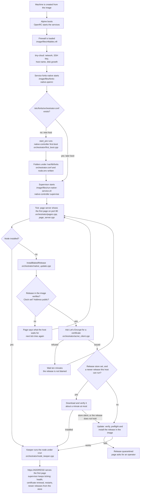

# From a new machine to a running node

A machine created from the node host image
([image/build-image.sh](../image/build-image.sh)) installs itself. Nobody logs
in. The chart shows what happens, in order, and which file starts each step.

| Step | What happens | Started by | Code |
| --- | --- | --- | --- |
| 1 | The firewall is loaded before the network comes up: only ports 22, 80 and 443 are reachable | OpenRC, `boot` runlevel, service `nftables` | [image/files/nftables.nft](../image/files/nftables.nft) |
| 2 | Network address, the operator's SSH key, host name, disk grown to the machine's size | OpenRC, the four `tiny-cloud` services of the base image | Alpine's `tiny-cloud` package |
| 3 | The `fortis-native` service starts once the network, the clock service and the firewall are up | OpenRC, `default` runlevel | [image/files/fortis-native.openrc](../image/files/fortis-native.openrc), `depend()` |
| 4 | On a new host only: optional settings are taken from user data, then the host is laid out. Folders under `/var/lib/fortis`, then `/etc/fortis/node.env` and `/etc/fortis/orchestrator.conf`. The configuration file is written last, so an interrupted first boot runs again | `start_pre()` of the service, which runs `native-controller /etc/fortis/orchestrator.conf first-boot` | [orchestrator/first_boot.cpp](../orchestrator/first_boot.cpp), `FirstBoot` |
| 5 | The supervisor starts and stays for as long as the host is up. OpenRC restarts it if it ends | The service's `command` | [image/files/run-native-service.sh](../image/files/run-native-service.sh), then [image/files/manage-native-node.sh](../image/files/manage-native-node.sh), then `native-controller ... supervise` |
| 6 | Each tick with no node installed: the health and first pages are written and the page server shows them on port 80 | The supervisor's tick | `PublishHealth` and `ShowPagesWhileStopped` in [orchestrator/native_update.cpp](../orchestrator/native_update.cpp); [orchestrator/pages.cpp](../orchestrator/pages.cpp); [orchestrator/page_server.cpp](../orchestrator/page_server.cpp) |
| 7 | The release in the image is verified against the image's key. The host then waits until the clock is set and checks that its address is public | The same tick | `InstallBakedRelease` in [orchestrator/native_update.cpp](../orchestrator/native_update.cpp); `ClockSynchronised` and `PublicAddress` in [orchestrator/first_boot.cpp](../orchestrator/first_boot.cpp) |
| 8 | A certificate for the address is requested. The page server answers the authority's check on port 80. A refusal is retried after ten minutes | `InstallBakedRelease` calls `Certificates` | [orchestrator/acme_client.cpp](../orchestrator/acme_client.cpp), `Issue` |
| 9 | Only when a release store is set (none is by default) and automatic updates are on: the store's signed release list is fetched, and if it has a newer release than the image's that this host can run, that one is downloaded, verified and installed at once. The store gets about a minute. If it does not answer, has nothing newer, or its release does not hold, step 10 follows | `InstallBakedRelease` calls `InstallNewestFromStore` | `InstallNewestFromStore`, `CheckReleases` and `InstallCandidate` in [orchestrator/native_update.cpp](../orchestrator/native_update.cpp); [releases.md](releases.md#automatic-updates) |
| 10 | The node release in the image is installed the same way any update is: verified, tried, then made current | `InstallBakedRelease` calls `Update` | `Update` in [orchestrator/native_update.cpp](../orchestrator/native_update.cpp) |
| 11 | The node runs in its own container and serves `https://ADDRESS/`. Later ticks watch its health, renew the certificate, restart it if it stops and, with a store, install newer releases | The keeper and the supervisor's tick | [orchestrator/node_keeper.cpp](../orchestrator/node_keeper.cpp); `RenewCertificates` and `AutomaticUpdate` in [orchestrator/native_update.cpp](../orchestrator/native_update.cpp) |

The same files are also packaged as a container image; there, steps 1 to 3
are done by Docker and the server. See [One build, three images](images.md).

Steps 7 to 10 are tried again at every tick until they succeed, and the first
page says in one sentence what the host is waiting for. Everything is logged
to `/var/log/fortis-orchestrator.log`. What can be set when the machine is
created is described in
[image/README.md](../image/README.md#settings-at-creation-when-wanted).

## How a host finds its public address

A certificate is issued for the address the world reaches the host at. On a
DigitalOcean Droplet that address is on the machine's own network interface.
Inside a container, and on clouds that translate addresses (Amazon and
Google do), the host only sees a private address such as `172.17.0.2`.

When that happens the orchestrator asks two public services, over HTTPS,
"which address do you see me coming from?", and uses the answer when both
agree and it is a public address (`FindPublicAddress` in
[orchestrator/native_update.cpp](../orchestrator/native_update.cpp)). The
answer is not simply trusted: the certificate authority then connects to
that address itself, and only a host that really answers there gets a
certificate. A wrong answer therefore costs a failed request, nothing more.

| Setting | Meaning |
| --- | --- |
| `FORTIS_HTTPS_IP` | Give the address yourself; then nobody is asked |
| `FORTIS_NATIVE_ADDRESS_LOOKUP` | The services to ask, separated by spaces. Default `https://checkip.amazonaws.com https://icanhazip.com`. `off` asks nobody |
