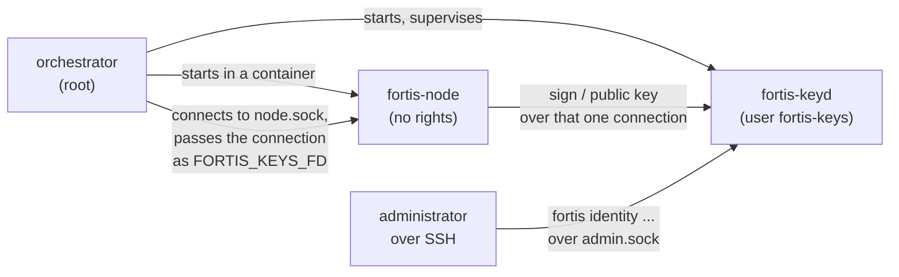
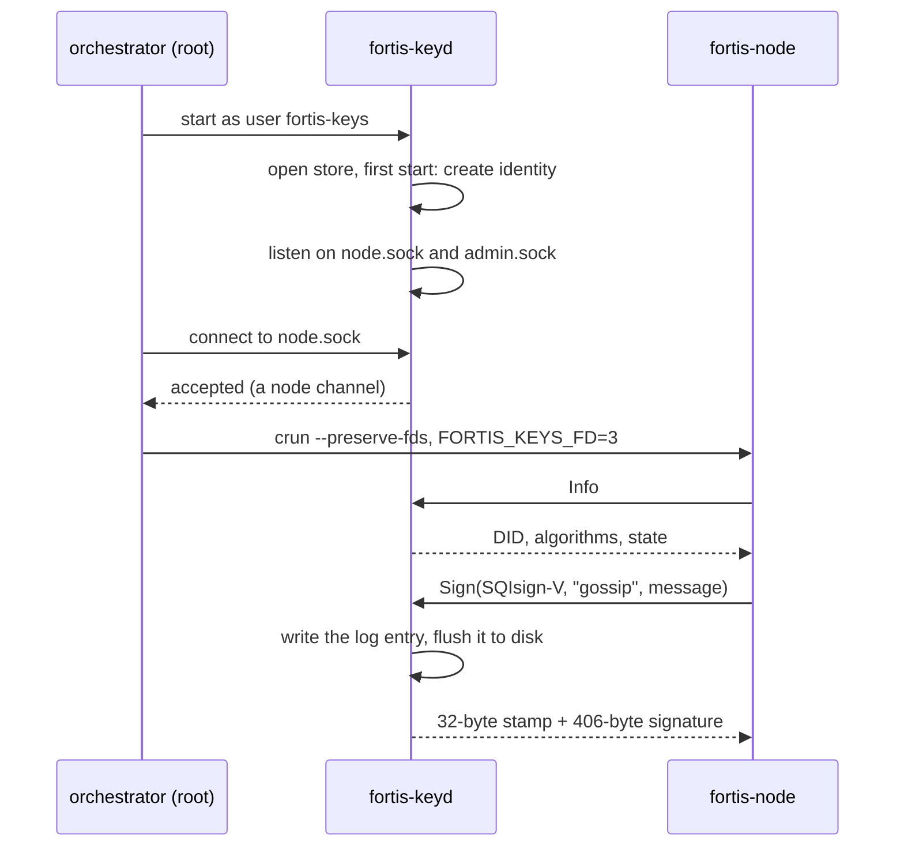

# Fortis DID: the node's post-quantum identity, kept by the host

Every FortisNet node has an identity: a name that other nodes can check
without asking anybody, and secret keys that prove "this message really comes
from that node". This document describes how Node OS creates that identity,
keeps its secret keys away from the node program that uses them, lets the node
sign with them very quickly anyway, and lets an administrator move them to
another machine safely.

It is written for a reader who has finished a first programming course. Every
idea is explained before it is used. The second half goes down to the bytes on
the wire, for the people who will write and review the code.

| Section | What it answers |
| --- | --- |
| [1. The idea in one page](#1-the-idea-in-one-page) | What is built, and why |
| [2. Words you need](#2-words-you-need) | Key pair, signature, hash, DID, process, file descriptor |
| [3. Why a library cannot keep a secret](#3-why-a-library-cannot-keep-a-secret) | The problem |
| [4. The design](#4-the-design) | The parts and how they fit |
| [5. Why these methods](#5-why-these-methods-and-not-others) | Every choice, with the alternatives that were rejected |
| [6. The three signature algorithms](#6-the-three-signature-algorithms) | ML-DSA-87, SQIsign-V, secp256k1 |
| [7. The keys a host holds](#7-the-keys-a-host-holds) | Node identity, machine key, roots and runtime keys |
| [8. Unix sockets from the beginning](#8-unix-sockets-from-the-beginning) | How two programs on one machine talk |
| [9. How the node reaches the key service](#9-how-the-node-reaches-the-key-service) | The connection, step by step |
| [10. The wire protocol](#10-the-wire-protocol-byte-by-byte) | Every byte of a request and a reply |
| [11. Domain separation, stamps and the signing log](#11-domain-separation-stamps-and-the-signing-log) | Why the node cannot sign "just anything", and how other nodes notice misused keys |
| [12. Using it from the node, in C++](#12-using-it-from-the-node-in-c) | Step by step for the node's developers, and code examples |
| [13. Inside fortis-keyd](#13-inside-fortis-keyd) | Threads, memory, files, first start, the DID on the host's pages |
| [14. Speed](#14-speed) | Where the time goes |
| [15. Copying an identity to another machine](#15-copying-an-identity-to-another-machine) | Several machines, one DID: export and import, safely |
| [16. Copied disks and cloned machines](#16-copied-disks-and-cloned-machines) | How every machine stays distinguishable |
| [17. What it protects against, and what it does not](#17-what-it-protects-against-and-what-it-does-not) | The honest limits |
| [18. Where the code is](#18-where-the-code-is) | Files, copied crypto code, tests |
| [19. Status](#19-status) | What is done and what is next |

---

## 1. The idea in one page

A node must sign things: its "hello" when it joins the network, its network
messages, and proofs that it controls an Ethereum-compatible account. Signing
needs a **secret key**. Whoever has the secret key *is* the node, as far as the
rest of the network can tell.

The node program (`fortis-node`, from
[FortisNet/node](https://github.com/FortisNet/node)) is large, talks to the
whole internet and runs code that may one day have a bug. If an attacker takes
it over, we want them to be able to do as little as possible, and in
particular **we do not want them to walk away with the keys**.

So the keys do not live in the node. They live in a small, separate program
that Node OS runs next to it: **`fortis-keyd`**, the key service. The node asks
it "please sign these bytes for purpose X", and gets back a signature. It
never sees a key.

```text
   ┌────────────────────────── one machine (Node OS) ──────────────────────────┐
   │                                                                           │
   │   orchestrator (administrator)            fortis-keyd (its own user)      │
   │   starts both, joins them                 holds every secret key          │
   │            │                                    ▲                         │
   │            │ hands over one end of a socket     │ "sign these bytes"      │
   │            ▼                                    │ "here is the signature" │
   │   ┌─── container ──────────────────────┐        │                         │
   │   │ fortis-node (no rights at all)     │────────┘                         │
   │   │ links the small client library     │  a Unix socket: the only way in  │
   │   └────────────────────────────────────┘                                  │
   └───────────────────────────────────────────────────────────────────────────┘
```

Five promises follow from that picture:

1. **The node can use the keys, but cannot read them.** A program cannot read
   another program's memory unless the operating system lets it, and here it
   does not.
2. **The node can only sign for purposes it is allowed.** The key service puts
   a label on everything it signs, so a signature made for one purpose can
   never be passed off as another (section 11).
3. **It is fast.** Asking another program costs a few microseconds. The
   signature itself costs hundreds of microseconds to hundreds of
   milliseconds. The extra safety is practically free (section 14).
4. **Misuse leaves evidence.** Every signature carries the key service's own
   stamp (which machine, which signature number, when) and is entered in a
   signing log before it is made. Other nodes can check a signature against
   the log, and two signatures with one number prove that a machine's keys
   are in two places (section 11).
5. **The identity can be copied, but only on purpose.** An administrator can
   copy it to another machine, encrypted so that only that machine can open
   it. Several machines may then sign as the same node at the same time, and
   every signature still shows which machine made it (sections 15 and 16).

On the very first start of a new machine, the key service creates the complete
identity by itself. Nobody types anything.

---

## 2. Words you need

**Key pair.** Two numbers that belong together: a *secret key* (private key),
which only its owner may ever know, and a *public key*, which anyone may know.
They are made together by a key generation algorithm from random bytes.

**Signature.** A short piece of data computed from a message and a secret key.
Anyone with the public key can check that the signature fits the message.
Nobody without the secret key can make one that fits. Change one bit of the
message, and the signature no longer fits.

```text
sign(secret_key, message)              -> signature
verify(public_key, message, signature) -> true or false
```

**Hash.** A function that turns any amount of data into a short, fixed-size
fingerprint (SHA-256 gives 32 bytes, SHA-512 gives 64). It is easy to compute
and practically impossible to run backwards or to find two inputs with the
same fingerprint.

**DID (decentralized identifier).** A name for an identity that needs no
registry. A Fortis DID is the hash of the identity's public keys:

```text
did:fortis:pq2:<the SHA-512 hash of the public manifest, as 128 hex characters>
```

The *public manifest* is a short document listing the identity's three public
keys (section 7). If someone shows you a manifest, you hash it and compare: if
the hash matches the DID you expected, those really are that identity's keys.
No server, blockchain or DNS is asked. The format is the `pq2` format already
specified in the FortisNet identity prototype (`FortisNet/test`,
`docs/THREE-ROLE-PQ2.md`).

**Post-quantum.** A large quantum computer, if one is ever built, could break
today's common signature algorithms (RSA, elliptic curves such as secp256k1).
*Post-quantum* algorithms are designed to resist it. Fortis identities use two
of them (ML-DSA-87 and SQIsign-V) and keep secp256k1 only for compatibility
with Ethereum accounts.

**Process.** A running program. The operating system (here Linux) gives every
process its own private memory. One process cannot read another's memory
unless the operating system explicitly allows it.

**User (UID).** Every process runs as a user, identified by a number. Files
belong to users, and the operating system decides who may do what by
comparing user numbers. The administrator is user 0, `root`.

**File descriptor (fd).** A small integer that a process uses to refer to
something the operating system has opened for it: a file, a pipe, a network
connection, or a socket. `0`, `1` and `2` are standard input, output and
error. When a process calls `open()` or `socket()`, it gets the next free
number. The number itself is meaningless outside the process; what matters is
the open object in the kernel that it points to.

**Kernel.** The core of the operating system. It enforces all of the above:
memory separation, users, permissions, and what a file descriptor refers to.

**Container.** A process that the kernel shows a restricted view of the
system: its own file tree, its own list of processes, no special rights. The
node runs in one, started by `crun`.

---

## 3. Why a library cannot keep a secret

The first idea many people have is: put the secret and the signing code into
a library, link it into the node, and let the node call `sign()`. The node's
programmers never see the secret in the source code, so it is hidden.

It is not. After linking, the library is part of the node's process. Its code,
its data and the secret key are all in the **same memory** as the rest of the
node:

```text
   One process: fortis-node
   ┌────────────────────────────────────────────────────┐
   │ node code          │ library code    │ SECRET KEY  │  <- all readable by
   │ node data          │ library data    │             │     any code in here
   └────────────────────────────────────────────────────┘
```

Any code running in that process can read any byte of that memory. A bug
that lets an attacker run their own code in the node lets them read the key.
So can a debugger, a crash dump file, or anyone who simply reads the library
file on disk if the key was compiled into it. Obfuscation only makes it slower
to find.

**The rule this document is built on:** a secret is protected only by a
boundary that the operating system enforces. The cheapest strong boundary on
Linux is the one between two processes running as two different users.

---

## 4. The design

| Part | What it is | Runs as |
| --- | --- | --- |
| **orchestrator** | The Node OS program that installs, starts, updates and recovers the node ([orchestrator/](../orchestrator)) | root |
| **fortis-keyd** | The key service. Creates and stores the keys, signs on request, never shows a key to the node ([keys/](../keys)) | its own user, `fortis-keys` |
| **fortis-node** | The node. Uses the keys through the key service | its own user, in a container with no rights |
| **key client library** | A small C++23 library the node links: connects to the key service and offers one function per algorithm ([keys/client/](../keys/client)) | inside the node |
| **`fortis identity` commands** | What an administrator types over SSH to see, back up, copy or retire an identity | root, over SSH |

How they connect:



The key service listens on two Unix sockets, in a folder only root and the
key service can open:

| Socket | Who connects | What it can be asked |
| --- | --- | --- |
| `/run/fortis/keys/node.sock` | Only the orchestrator, which hands each connection to the node | Public keys, stamped signatures, the DID and manifest, the machine statement, signing log checkpoints and entries. Nothing that reveals or changes a key |
| `/run/fortis/keys/admin.sock` | Only root, through the `fortis identity` commands | Status, backup, receive, export, import, retire |

The node can never open either socket itself: inside its container those
paths do not exist. It only has the one connection it was given.

---

## 5. Why these methods, and not others

This table is the reasoning behind the design. Each row is a decision, what
else was considered, and why it lost.

| Decision | Chosen | Rejected alternatives, and why |
| --- | --- | --- |
| Where the secret lives | **A separate process, as a separate user** | *A linked library:* same memory as the node (section 3). *A kernel module or a new system call:* the container image runs on somebody else's kernel and must not load modules; the disk image keeps Alpine's own kernel unchanged; and a kernel bug is far worse than a program bug. *A hardware enclave (SGX, TDX, TrustZone) or a TPM:* only some cloud machines have one, and Node OS must not depend on one cloud. They can be added later as an extra, never as the base |
| How the node talks to it | **A Unix socket, one connection handed over by the orchestrator** | *TCP on 127.0.0.1:* any local program could connect, and the kernel cannot tell the service which user is calling. *Shared memory:* saves microseconds on operations that take milliseconds (section 14), and is much harder to get right. *A pipe:* one direction only and no way to check the other end |
| What the node may ask | **Sign for a labelled purpose; never sign raw bytes; never read a key** | *A raw `sign(bytes)`:* a node taken over could sign an Ethereum transaction, or a message that another part of the protocol would accept as a hello (section 11) |
| Who creates the identity | **The key service, at the machine's first start** | *An administrator on another computer:* Node OS machines configure themselves, and nobody logs in to set them up |
| Where the keys rest | **Files only the key service's user can read** | *Encrypted with a password:* nobody is there at boot to type it, and a password stored next to the file protects nothing |
| Certificate lifetime for runtime keys | **24 hours by default, renewed automatically by the key service; one constant in the code (section 7)** | *One year:* the root key is on the host, so renewing costs nothing; a short-lived runtime key limits what a stolen or leaked key is worth, and existing verifiers already require at most 24 hours |
| Copying an identity | **Encrypted to a one-time key of the receiving machine *and* to a passphrase** | *A plain file:* one leak and the identity is gone. *A passphrase only:* anyone who guesses or overhears it can open a stolen file anywhere. *Plaintext "read" of keys:* keys would end up in terminals, logs and laptops |
| Several machines, one DID | **Allowed, without limits. Each machine has its own machine key and its own boot history** | *Only one machine at a time:* simpler to reason about, but it rules out running a node on several machines for capacity or availability |
| Telling machines apart | **A machine key that never leaves the machine, renewed when the cloud's instance number changes** | *Trusting the disk:* a copied disk carries everything on it, the machine key included |
| Crypto code | **Upstream reference code copied unchanged, only the files linked, behind a C++23 wrapper** | *A library from a package manager:* not allowed, the build must be self-contained. *Rewriting in C++:* a new, unreviewed implementation would lose the known-answer tests that vouch for the original |
| Where the key service lives | **A separate program in this repository, released with the orchestrator** | *Inside the orchestrator:* the orchestrator runs as root and must stay small enough to review; SQIsign is large, experimental and not constant-time, and does not belong in a root process |

---

## 6. The three signature algorithms

A Fortis identity has three roles, each with its own algorithm. They are
separate authorities: a signature for one role never counts for another.

| Role | Algorithm | Used for | Public key | Signature | Sign (measured) |
| --- | --- | --- | ---: | ---: | ---: |
| Chain accounts: EVM and XRPL | **secp256k1** (ECDSA) | Proving control of an Ethereum-compatible (EVM) account or an XRPL account | 65 B | at most 71 B, usually 70–71 | about 0.05 ms |
| FortisNet network | **SQIsign-V v3**, parameter set `p664_17` | Network messages and the hello | 169 B | 406 B | 165.7 ms |
| DID updates | **ML-DSA-87** (FIPS 204) | Updating the DID document; with SQIsign, the hello | 2,592 B | 4,627 B | 0.46 ms |

Timings are from the identity prototype on an Apple M3 Max with portable
code. Cloud processors are usually slower; section 14 explains what that
means.

**ML-DSA-87** is the post-quantum signature standardized by NIST in FIPS 204,
at its highest security level (category 5). It is based on lattices: the
secret is a set of small polynomials, and forging a signature would mean
solving a hard problem about short vectors in a high-dimensional lattice. It
is fast, well studied, and has large keys and signatures. It supports a
*context string*: a short label mixed into every signature, which section 11
uses.

**SQIsign-V** is a post-quantum signature based on isogenies between
elliptic curves (maps between curves, and the hard problem is finding one
between two given curves). Its keys and signatures are very small, which
matters when every network message carries one, but signing is slow and the
current upstream implementation is not constant-time: how long a signature
takes can depend on the secret key. It is a candidate in NIST's process, not a
standard.

**secp256k1** is the elliptic curve of Ethereum and other EVM chains, of
Bitcoin, and one of the two key types of XRPL accounts (the other is
Ed25519). It is not post-quantum. It is here so a node can prove which chain
accounts it controls.

What that means today, precisely:

- **One account key.** The identity has one secp256k1 key, in the manifest
  under the role `evm-account` (the identity prototype's format). Its public
  key gives both an EVM address (the last 20 bytes of Keccak-256 of the
  point) and an XRPL account ID (RIPEMD-160 of SHA-256 of the compressed
  point, written in XRPL's base58 alphabet): the same key can control an
  account on each chain.
- **Account-control proofs, not transactions.** Labelled signing proves
  control of the account to anyone who checks the signature (section 11). It
  never produces a native transaction for either chain, by design: a node
  taken over must not be able to move funds. EVM transactions and EIP-712
  data, and XRPL transactions, have their own encodings, hashes and replay
  rules; each will be a separate operation of the key service, with its own
  limits (chain, account, maximum amount), when it is needed.
- **One key per chain is better, and planned.** The identity prototype
  advises separately derived keys for different chains rather than one
  scalar for both, so that a mistake on one chain cannot touch the other.
  The master already derives keys by label (`evm:secp256k1:i`); an XRPL key
  would be `xrpl:secp256k1:i`. Adding it to the manifest is a change of the
  identity format, and changes the DID, so it belongs with the next version
  of that format.

---

## 7. The keys a host holds

There are two kinds of identity on a host, and keeping them apart is the
central idea of the design.

| | **Node identity** | **Machine key** |
|---|---|---|
| What | The DID and every role key | A key pair made once, for this installation |
| Made | At the first start of the first machine it lives on | At the first start of every installation |
| Can move | Yes, encrypted, by the administrator | **Never.** Not exported, not in any backup |
| Used for | Everything the node signs | Receiving a copied identity, telling machines apart |

The node identity contains:

| Key | Algorithm | Purpose | Who may use it |
| --- | --- | --- | --- |
| DID-update root | ML-DSA-87 | In the manifest. Signs DID updates and certifies runtime keys | Only the key service itself |
| Network root | SQIsign-V | In the manifest. Certifies runtime keys | Only the key service itself |
| Account key | secp256k1 | In the manifest. Account-control proofs | The node, through labelled signing |
| Runtime ML-DSA key | ML-DSA-87 | Signs on behalf of the identity for 24 hours | The node, through labelled signing |
| Runtime SQIsign key | SQIsign-V | Signs network messages for 24 hours | The node, through labelled signing |

**Why roots and runtime keys.** The root keys are in the manifest, so they
*are* the DID: replacing one means a new DID. They are used rarely, only by
the key service, and never on the node's behalf. The node signs with runtime
keys, which the roots certify for 24 hours at a time. If a runtime key leaks,
it is worthless after its certificate expires, and the identity stays the same.

**Why automatic renewal is safe here.** In the identity prototype the roots
are kept on an offline computer, so renewing a certificate needs a person.
On a Node OS host the roots are in the key service, so it makes a fresh
runtime key and certificate every day by itself. The node never touches a
root.

### 7.1 The certificate lifetime, and where to change it

The lifetime of a runtime certificate is one constant,
`kRuntimeCertificateLifetime` in [keys/key_policy.h](../keys/key_policy.h).
It is 24 hours. The key service renews a runtime key and its certificate when
less than a quarter of that lifetime is left
(`kRuntimeRenewalMargin`, in the same file), so a certificate is never close
to expiry while it is in use.

Why one day, and not a month or a year:

1. **It limits what a leaked runtime key is worth.** A runtime key is the key
   the node's requests reach, so it is the one most exposed: to a node that has
   been taken over, and to timing measurements of SQIsign (section 17). A key
   that expires tomorrow is worth one day to an attacker.
2. **Renewal costs nothing.** The roots are on the host, so no person is
   involved. One SQIsign key generation and two root signatures a day take
   well under a second.
3. **Verifiers already require it.** The identity format accepts runtime
   certificates of at most 86,400 seconds. A longer lifetime would be refused
   by every peer until that limit is changed there as well.

To change it, change `kRuntimeCertificateLifetime`, and if it becomes longer
than 24 hours, change the verifiers' limit in the identity format in the same
release, and then `kVerifierLifetimeLimit` beside it. Static checks in
`keys/key_policy.h` refuse a lifetime shorter than one hour or longer than
what verifiers accept (`kVerifierLifetimeLimit`, 24 hours), and a renewal
margin that is not shorter than the lifetime, so the build refuses a lifetime
that every peer would refuse. When certificates are issued, their start will
be set slightly in the past, within the 24 hours, so that a peer whose clock
is a little behind still accepts them.

The machine key is an ML-DSA-87 key pair. Its **machine ID** is the first 16
bytes of the SHA-512 hash of its public key, written as 32 hex characters.
Receiving a copied identity uses a separate one-time ML-KEM-1024 key made for
each transfer (section 15), so the machine ID never changes.

---

## 8. Unix sockets from the beginning

The node and the key service are two processes, and processes cannot read
each other's memory. To work together they need a channel the kernel
provides. On Linux the standard one for programs on the same machine is the
**Unix domain socket**.

### 8.1 What a socket is

A socket is one end of a two-way communication channel. Data written into one
end comes out of the other, in order. You have probably met sockets for
network connections (TCP); a Unix socket is the same idea, except that both
ends are on the same machine and the data never touches a network card. The
kernel copies the bytes straight from one process to the other.

A Unix socket is named by a path in the file tree, such as
`/run/fortis/keys/node.sock`, instead of an IP address and a port. That path
has an owner and permissions like any file, so the ordinary file permission
rules decide who may connect.

### 8.2 The life of a connection

A server and a client go through these system calls:

```text
   server (fortis-keyd)                         client
   ────────────────────                         ──────
   fd = socket(AF_UNIX, SOCK_STREAM)
   bind(fd, "/run/fortis/keys/node.sock")
   listen(fd)
                                                c = socket(AF_UNIX, SOCK_STREAM)
                                                connect(c, "/run/fortis/keys/node.sock")
   conn = accept(fd)   <-- a new fd, one per client
   read(conn) ...      <----------------------  write(c, request)
   write(conn, reply)  ---------------------->  read(c) ...
   close(conn)                                  close(c)
```

- `socket()` creates an unconnected socket and returns its file descriptor.
- `bind()` gives it a path. The path now appears in the file tree as a socket
  file.
- `listen()` says "I will accept connections".
- `connect()` on the client side connects to that path. The kernel checks that
  the client may write to the socket file.
- `accept()` on the server side returns a *new* file descriptor for this one
  client. The listening socket keeps waiting for more.
- From then on, `read()`/`recv()` and `write()`/`send()` move bytes both ways.

`AF_UNIX` means "Unix socket". `SOCK_STREAM` means a stream of bytes, like a
TCP connection: the kernel keeps the order and loses nothing, but it does not
keep message boundaries. Two writes of 10 bytes may be read as one read of 20,
or as reads of 3 and 17. That is why the protocol (section 10) puts the length
of each message at its start.

### 8.3 Asking the kernel who is calling: `SO_PEERCRED`

When a client connects, the kernel records its process ID, user and group.
The server can ask for them, and the answer cannot be faked by the client,
because it comes from the kernel:

```cpp
#include <sys/socket.h>

ucred peer{};
socklen_t size = sizeof(peer);
if (getsockopt(conn, SOL_SOCKET, SO_PEERCRED, &peer, &size) == 0) {
  // peer.pid, peer.uid, peer.gid are those of the process that connected.
  if (peer.uid != 0) { /* refuse: only root may use admin.sock */ }
}
```

The key service uses this on `admin.sock`: only user 0 is served. On
`node.sock` only the orchestrator (user 0) can connect, because of the folder
permissions, and it then hands the connection to the node.

### 8.4 A connection can change hands

A file descriptor refers to an open object in the kernel. Two ways let it
reach another process:

1. **Inheritance.** When a process starts a new program (`fork()` then
   `exec()`), the new program receives the open file descriptors that were
   not marked "close on exec". The orchestrator uses this to start the node
   with exactly the descriptors it wants it to have, through `crun
   --preserve-fds`. Node OS already hands the node its listening network
   sockets this way (`FORTIS_LISTEN_FDS`).
2. **Passing over a socket (`SCM_RIGHTS`).** A process can send an open file
   descriptor to another process through a Unix socket, as an attachment to a
   message. The receiver gets a new number referring to the same open object.

Once the node has the connection, it can use it, but it cannot find out the
socket's path, open a second one, or reach any other socket: it never had the
path, and its container does not contain it.

### 8.5 A pair without a path: `socketpair()`

`socketpair(AF_UNIX, SOCK_STREAM, 0, fds)` creates two sockets already
connected to each other, with no path at all. The key service uses it to give
the node a *second*, independent connection when it asks for one (section
10.4), so that several threads of the node can sign at the same time.

### 8.6 Why not TCP on 127.0.0.1

- Any program on the machine could connect to a TCP port. A Unix socket is
  guarded by file permissions.
- With TCP the server cannot ask the kernel which user is calling.
- File descriptors can only be passed over a Unix socket.
- A Unix socket skips the network stack and is faster.

---

## 9. How the node reaches the key service

This is what happens, in order, from the machine starting to the node's
first signature.

1. **The orchestrator starts the key service.** It does what it already does
   for its own helpers: `fork()`, switch to the user `fortis-keys`, start
   `/usr/libexec/fortis/fortis-keyd`. It then watches it and restarts it if it
   stops.
2. **The key service opens its store** in `/var/lib/fortis/keys/` (only its
   user may read it). On the machine's first start the store is empty, so it
   makes the machine key and the complete node identity (section 13.4).
3. **The key service listens** on `node.sock` and `admin.sock` in
   `/run/fortis/keys/`. The folder belongs to `fortis-keys`, with mode `0700`,
   so only it and root can reach the sockets.
4. **The orchestrator connects** to `node.sock` as root. The key service
   accepts and marks this connection as a *node channel*: it can ask for public
   keys and labelled signatures, and nothing else.
5. **The orchestrator starts the node** in its container with `crun
   --preserve-fds`, keeping that connection open, and sets the environment
   variable `FORTIS_KEYS_FD` to its number inside the container. The release
   manifest of a node that understands this says so with its host interface
   number (`host_interface`), so an older node is never given a connection it
   does not expect.
6. **The node's client library** reads `FORTIS_KEYS_FD`, checks that it is a
   Unix stream socket, and from then on sends requests on it.
7. **When the node restarts** (an update, a crash), the orchestrator makes a
   new connection and gives it to the new node. The old one is closed with the
   old node.



---

## 10. The wire protocol, byte by byte

Every message, in both directions, is a 16-byte header followed by a body.
All numbers are unsigned and big-endian (most significant byte first).

### 10.1 The header

| Offset | Size | Field | Value |
| ---: | ---: | --- | --- |
| 0 | 4 | magic | The ASCII bytes `F K D 1` |
| 4 | 1 | direction | `0` for a request, `1` for a reply |
| 5 | 1 | code | In a request, the operation. In a reply, the result |
| 6 | 2 | reserved | `0`; anything else is refused |
| 8 | 4 | request ID | Chosen by the client, copied into the reply |
| 12 | 4 | body length | `0` to the limit of the operation |

The magic and the version in it (`1`) let either side refuse anything that is
not this protocol. The reserved field must be zero so that a later version can
use it without old programs misreading it. The request ID lets the client
match replies to requests.

Limits: a request body is at most 1,048,576 + 66 bytes (a 1 MiB message,
the algorithm and label length bytes, and a label of up to 64 bytes), a reply
body at most 65,536 bytes. Anything longer is refused
before it is read, so a broken or hostile client cannot make the service
allocate memory without limit.

### 10.2 Operations

| Code | Operation | Request body | Reply body on success |
| ---: | --- | --- | --- |
| 1 | `Info` | empty | See 10.3 |
| 2 | `PublicKey` | `algorithm` (1 byte) | The public key bytes |
| 3 | `Sign` | `algorithm` (1), `label length` (1), `label`, `message` (the rest) | The 32-byte stamp, then the signature bytes (section 11.2) |
| 4 | `OpenChannel` | empty | Empty; a new connection is attached with `SCM_RIGHTS` |
| 5 | `Manifest` | empty | The identity's public manifest, which hashes to the DID |
| 6 | `MachineStatement` | empty | This machine's statement, signed by the identity's ML-DSA-87 root (section 11.4) |
| 7 | `Checkpoint` | the entry to cover (u64; 0 for the latest) | A checkpoint of the signing log, signed by the machine key (section 11.3) |
| 8 | `LogEntries` | the first entry (u64), how many (u16, at most 256) | The head before the first entry, the count, the entries (section 11.3) |

Operations 5 to 8 return only public data. The node relays it to peers, who
check it with the functions of [key_log.h](../keys/client/key_log.h)
(section 11.5).

Algorithm numbers:

| Number | Algorithm | Key used |
| ---: | --- | --- |
| 1 | ML-DSA-87 | The runtime ML-DSA key |
| 2 | SQIsign-V v3 `p664_17` | The runtime SQIsign key |
| 3 | secp256k1 | The account key |

A label is 1 to 64 bytes from `a-z`, `0-9`, `.`, `_` and `-`. It names the
purpose of the signature, for example `gossip` or `peer-receipt` (section 11).

### 10.3 Results

| Code | Result | Meaning |
| ---: | --- | --- |
| 0 | `Ok` | Done; the body is the answer |
| 1 | `BadRequest` | The request is malformed: wrong length, unknown algorithm, bad label |
| 2 | `Denied` | Not allowed on this socket |
| 3 | `Busy` | Too many signatures are being made at once; try again shortly |
| 4 | `Unavailable` | The key service cannot do it now, for example while it is starting |
| 5 | `Failed` | The algorithm failed, or the signing log could not be written; nothing was signed |

The `Info` reply body is:

```text
u8   state               0 = ready
u8   did length          then the DID, ASCII
u8   machine-id length   then the machine ID, ASCII hex
u8   algorithm count     then that many algorithm numbers
```

### 10.4 One connection per thread: `OpenChannel`

The key service answers requests on one connection in order, one at a time.
To sign in parallel, a node thread asks for its own connection with
`OpenChannel`. The key service makes a `socketpair()`, keeps one end as a new
node channel, and sends the other end back attached to the reply with
`SCM_RIGHTS`. Each connection is served by its own thread in the key service,
so as many signatures run at once as there are processor cores. The number of
node channels is limited (64), so a node cannot exhaust the service's threads.

### 10.5 An example on the wire

The node asks for a secp256k1 signature, labelled `demo`, of the 5-byte
message `hello`. Request ID 7:

```text
46 4b 44 31   magic "FKD1"
00            request
03            Sign
00 00         reserved
00 00 00 07   request ID 7
00 00 00 0b   body: 11 bytes
   03            algorithm 3, secp256k1
   04            label length 4
   64 65 6d 6f   "demo"
   68 65 6c 6c 6f "hello"
```

The reply:

```text
46 4b 44 31   magic
01            reply
00            Ok
00 00
00 00 00 07   request ID 7, copied
00 00 00 66   body: 102 bytes
   23 f0 fa 94 ... 54 e5     the stamp: machine ID (16 bytes)
   00 00 00 00 00 00 00 2a   signature number 42
   00 00 00 00 69 28 8c 00   time, Unix seconds
   30 44 02 20 ...           a DER-encoded ECDSA signature, 70 bytes
```

---

## 11. Domain separation, stamps and the signing log

This section answers two questions. How does the key service stop a node
that has been taken over from turning a signature into something else
(11.1)? And how can *other* nodes notice when an identity's keys are misused:
copied to a second machine, or used outside the key service (11.2 to 11.6)?

### 11.1 Domain separation: why the node cannot sign "just anything"

Suppose the key service signed any bytes the node sent. An attacker who took
over the node could then:

- send the hash of an **Ethereum transaction** to the secp256k1 key, and get a
  valid transaction that empties the account;
- send bytes laid out exactly like a **hello** or a **DID update**, and get a
  signature that other nodes accept as one, although the key service never
  checked its contents.

The defence is called **domain separation**: before signing, the key service
mixes a fixed tag and the label into what is signed. A signature made for one
domain is then useless in any other domain, because the bytes that were
signed are different, and the attacker cannot choose them freely.

For a `Sign` request with label `L` and message `M`, let
`D = "fortis/app/" + L`, and let `S` be the 32-byte stamp the key service
chooses for this signature (section 11.2). The key service signs:

| Algorithm | What is actually signed |
| --- | --- |
| ML-DSA-87 | `S M`, with the FIPS 204 context string set to `D` |
| SQIsign-V | `"FORTIS-SQI-APP" 0x00 len(D) D S M` |
| secp256k1 | The 32-byte hash `SHA-256("FORTIS-K1-APP" 0x00 len(D) D S M)`, with deterministic ECDSA (RFC 6979), low `s`, DER-encoded |

`len(D)` is one byte. Because the length comes first, two different
(label, message) pairs can never produce the same signed bytes.

Why each one is safe:

- **ML-DSA-87.** FIPS 204 mixes the context string into the signature
  itself. The hello, certificates and DID updates are signed with an empty
  context, and labelled signing never uses an empty one. The key service's
  own signatures use contexts that labelled signing can never produce,
  because they do not start with `fortis/app/`: `fortis/signing-log` for
  checkpoints and `fortis/machine-statement` for machine statements.
- **SQIsign-V.** It has no context string, so the tag is placed in front of
  the message. Everything the identity format signs with SQIsign (the
  network certificate, role proofs, the hello) is a sequence of fields, each
  starting with its 4-byte big-endian length, so its **first byte is always
  `0x00`** (a field would have to be 16 MiB long to start otherwise). A
  labelled message always starts with `F` (`0x46`). The two can never be the
  same bytes. This is a rule for every future protocol operation of the key
  service: what it signs must start with `0x00`, never with
  `FORTIS-SQI-APP` or `FORTIS-K1-APP`.
- **secp256k1.** The key service computes the hash itself, from bytes that
  begin with `FORTIS-K1-APP`. The identity format's account proofs hash bytes
  that begin with `0x00`, for the same reason as above, so the two hashes are
  of different inputs. To turn that into a valid Ethereum transaction
  the attacker would need a SHA-256 input that starts with that tag and hashes
  to the Keccak-256 hash of a transaction they choose. Nobody can find such an
  input. Real Ethereum signing (EIP-1559 transactions, EIP-712 typed data) is
  not offered; if it is ever needed, it will be a separate operation with its
  own rules, such as an allowed chain and a maximum value.

The protocol operations of the identity format (the five-signature hello,
network proofs, DID updates) will be separate operations in which the key
service builds the exact transcript itself, checks expiry and certificates,
and signs with the reserved domains. The node will send the fields, never the
transcript.

Verifying needs no secret, so the node verifies by itself, with the same
construction. The client library provides `Verify` (section 12).

### 11.2 The stamp: which machine, which signature, when

Every labelled signature carries a **stamp** of 32 bytes. The key service
chooses it; the node can neither choose it nor leave it out, because it is
inside what is signed (11.1):

| Bytes | Field | Meaning |
| ---: | --- | --- |
| 16 | machine ID | The machine whose key service signed (section 7) |
| 8 | sequence number | 1, 2, 3, ... on this machine, never given twice, not even across a crash |
| 8 | time | Unix seconds, from the key service's clock |

A signature travels with its stamp: the `Sign` reply, and what the node sends
to peers, is the stamp followed by the signature (`EncodeStamped`). A peer
checks both with `Verify(algorithm, public key, label, message, stamped)`. A
changed stamp fails like a changed message.

Why the key service, and not the node, chooses it: a value the node chose
would prove nothing about the node, since a node that has been taken over
chooses whatever it likes. A value only the key service writes, under keys the
node cannot read, says something the node cannot fake: *this* signature was
made by *that* machine's key service, as its *n*-th.

### 11.3 The signing log

Before it makes a labelled signature, the key service writes one entry to
`signing.log`, and it does not sign until the entry is on disk:

```text
entry = sequence u64 || time u64 || algorithm u8 || len(label) u8 || label || SHA-256(message)
head(0) = 32 zero bytes
head(n) = SHA-256("FORTIS-SIGNING-LOG-v1" 0x00 || head(n-1) || entry(n))
```

Each **head** is the hash of the previous head and the new entry, so the
newest head is a fingerprint of the whole log: changing, removing or
reordering any entry changes every head after it. The log keeps only the
SHA-256 of each message, never the message itself.

A **checkpoint** is the head after a given entry, signed by the machine key:

```text
checkpoint = field("FORTIS-LOG-CHECKPOINT-v1") machine[16] sequence u64 time u64 head[32]
             field(machine public key)  ||  ML-DSA-87 signature (context "fortis/signing-log")
```

where `field(x)` is a 4-byte big-endian length and `x`. Only the key service
holds the machine key, so only it can make a checkpoint for its machine ID,
and the machine ID is the hash of the public key inside, so a checkpoint
cannot be passed off as another machine's.

How the file works, and why:

- **Fixed-size records** of 146 bytes: the entry, the label padded to 64
  bytes, and the head after it. Any entry, and the head at any past entry, is
  read directly, so a checkpoint can be made for any entry, not only the
  latest.
- **On disk before the signature.** A signature never exists without its
  entry. When several signatures arrive at once, they share one disk flush
  (`fdatasync`), so the cost is one flush per batch, not per signature.
- **A sequence number is never given twice.** The next number comes from the
  log itself. A crash can leave the last record cut short; that record was
  never flushed, so its signature was never made, and the key service removes
  it at the next start. Its number may then be given again, but it was never
  given out.
- **A damaged log stops the service.** At every start the key service reads
  the whole log and checks that each record follows the previous one and that
  each head is right. Anything else wrong refuses to start, naming the entry.
- **It fails closed.** If the log cannot be written, for example on a full
  disk, the key service refuses every signature (`Failed`) until it restarts,
  rather than sign without a record.

The log grows by 146 bytes per signature, so about 140 MB per million
signatures. Archiving old entries, while keeping the checkpoints that cover
them, is planned.

### 11.4 Tying a machine to the identity: the machine statement

A checkpoint proves that *some* machine key signed it. A peer also needs to
know that this machine belongs to the identity, or anyone could make a
machine key of their own and a log to match. The **machine statement** ties
them together:

```text
statement = field("FORTIS-MACHINE-STATEMENT-v1") field(DID) machine[16]
            field(machine public key) time u64
            ||  ML-DSA-87 signature by the identity's DID-update root (context "fortis/machine-statement")
```

The key service signs it at every start. A peer checks it with the ML-DSA-87
root public key from the identity's manifest, which it trusts because the
manifest hashes to the DID. The chain of trust a peer follows is:

```text
DID ──hash──► manifest ──contains──► ML-DSA-87 root
                                         │ signs
                                         ▼
                              machine statement ──names──► machine key
                                                              │ signs
                                                              ▼
                                                         checkpoint ──head──► log entries
```

Someone who stole only the runtime keys cannot make a machine statement, so
cannot invent a machine or a log. Someone who stole the root keys can; that is
the limit in section 17.

### 11.5 What other nodes can check, and how

The node relays its key service's public data (operations 5 to 8). Everything
a peer needs is in [key_log.h](../keys/client/key_log.h), with no secret:

**1. That a signature is in the machine's log.**

```cpp
#include "key_log.h"
using namespace fortis::keys;

// The peer trusts only the DID it expects. The rest comes from the node.
bool InLog(std::string_view did, View manifest, View statement_bytes, View checkpoint_bytes,
           View entries_bytes, Algorithm algorithm, std::string_view label, View message,
           const StampedSignature& signature) {
  if (DidOf(manifest) != did) return false;                          // the manifest is the DID's
  const auto roots = ParseManifest(manifest);
  if (!roots) return false;
  const auto statement = VerifyStatement(statement_bytes, roots->update_root, did);
  if (!statement) return false;                                      // the machine is the identity's
  const auto checkpoint = VerifyCheckpoint(checkpoint_bytes, *statement);
  const auto segment = DecodeSegment(entries_bytes);
  return checkpoint && segment &&                                    // the log, up to the checkpoint
         Records(*segment, *checkpoint, algorithm, label, message, signature.stamp);
}
```

The peer asks for a checkpoint at the signature's sequence number
(`Checkpoint(n)`) and for that one entry (`LogEntries(n, 1)`): two small
replies prove that entry *n* is in the log as of entry *n*. A valid signature
whose entry is missing, or different, was made **outside the key service**:
its keys were stolen.

**2. That two key services share one machine's keys (a clone).** An honest
key service never gives a sequence number twice. So two different valid
signatures with the same machine ID and sequence number, or two checkpoints
of one machine at one sequence number with different heads, are proof that
two copies of that machine's keys are signing: a cloned disk, or stolen keys.
The proof is the two signatures themselves; anyone can check it, and nobody
who does not hold the keys could have made it.

```cpp
const SignedRecord a{Algorithm::Secp256k1, account_key, "vote", message_a, stamped_a};
const SignedRecord b{Algorithm::Secp256k1, account_key, "vote", message_b, stamped_b};
if (ProvesClone(a, b)) { /* report the machine: its keys are in two places */ }
if (ProvesClone(checkpoint_x, checkpoint_y)) { /* the same, from its own checkpoints */ }
```

The public keys in a `SignedRecord` must be the identity's, as the peer knows
them (the manifest's account key, or certified runtime keys). Anyone can sign
a stamp with a key of their own, so a proof made with an unknown key proves
nothing; `ProvesClone` checks only the signatures.

**3. How much a machine signs, and when.** Sequence numbers and times show a
machine's rate of signing, and checkpoints show its total. A sudden jump is
visible to every peer that sees its signatures.

### 11.6 What this cannot catch

- **Allowed signatures with harmful content.** A node that has been taken
  over can still ask for labelled signatures, and each one is in the log as
  it should be. Two contradictory votes, for example, are both "legitimate"
  signatures; only the network protocol can say they conflict. The remedy is
  for the key service to refuse a second, different signature for the same
  slot, as validator key services do (Ethereum's slashing protection,
  EIP-3076). It needs the consensus protocol's definition of a slot, and is
  planned with it.
- **Stolen root keys.** Whoever has the roots can make machine statements,
  machine keys, checkpoints and logs of their own. Only a new identity helps.
- **A node that will not relay its log.** The log can only be checked through
  the node. A node that refuses is not proven guilty, but its signatures can
  no longer be checked, and peers can treat them that way.
- **The time** is the key service's clock. It shows when a machine *says* it
  signed, and is only as right as that clock.
- **Privacy.** Sequence numbers and times tell anyone who sees signatures how
  active a node is. Every signature already reveals its machine ID.

---

## 12. Using it from the node, in C++

### 12.0 Step by step, for the node's developers

What `fortis-node` does to sign with its identity, in order:

1. **Copy the code.** Copy [keys/client/](../keys/client) and
   [third_party/crypto/](../third_party/crypto) into the node, with their
   manifest entries, the way node-os keeps its copies of the node's files in
   `lib/`. Build the C files as this repository's [Makefile](../Makefile)
   does (`SQISIGN_DEFINES`, `MLDSA_DEFINES`), and link Mbed TLS, which the
   node already builds. Nothing else is needed.
2. **Say that the node can use it.** The release manifest names the host
   interface number that includes `FORTIS_KEYS_FD` (section 9), so that only
   a host that hands over a key channel starts this node.
3. **Connect once, at start.** `Client::FromEnvironment()` takes the
   connection the orchestrator handed over. Keep it for the life of the
   process. If it is missing, the node runs without signing.
4. **One channel per thread that signs.** A `Client` answers one request at a
   time. Each thread that signs takes its own with `OpenChannel()`, at most
   64 in all, and keeps it.
5. **Sign with a label that says what for.** `Sign(algorithm, label,
   message)` returns a `StampedSignature`. Any label works (section 10.2);
   use one per kind of message, so a signature of one kind can never be
   taken for another.
6. **Send the stamp with the signature.** `EncodeStamped()` gives the bytes
   to send: the stamp, then the signature. The receiver checks them with
   `Verify(algorithm, public_key, label, message, stamped)`.
7. **Publish what peers need to check the log.** Serve the manifest, the
   machine statement, checkpoints and log entries from the key service
   (`Manifest()`, `MachineStatement()`, `Checkpoint(n)`, `LogEntries(n,
   count)`), for example over the node's API, so that peers can check its
   signatures against the log (section 11.5).
8. **Handle refusals.** Every call throws `std::runtime_error` on a refusal
   or a broken connection. `busy` means wait and try again; a broken channel
   is closed, and the thread opens a new one. Nothing is retried for you.
9. **Give verifying threads enough stack.** `Verify` needs about 128 KiB of
   stack (section 12, [key_client.h](../keys/client/key_client.h)); use
   threads of at least 256 KiB.

A whole program that does all of this is
[tests/key_client_tool.cpp](../tests/key_client_tool.cpp), which the tests
run against a real key service.

The client library is [keys/client/](../keys/client): one header for the node
to include, [key_client.h](../keys/client/key_client.h), and the verification
code in [key_algorithms.h](../keys/client/key_algorithms.h). The node copies
the whole folder and [third_party/crypto/](../third_party/crypto), and links
Mbed TLS, which it already builds. A complete small program that uses every
function is [tests/key_client_tool.cpp](../tests/key_client_tool.cpp). It is C++23, throws
`std::runtime_error` when the key service cannot be reached or refuses, and
never retries on its own.

### 12.1 Connect

```cpp
#include "key_client.h"

using fortis::keys::Algorithm;
using fortis::keys::Client;

// Uses the connection named by FORTIS_KEYS_FD. Throws if there is none.
Client keys = Client::FromEnvironment();

const auto info = keys.Info();
std::printf("I am %s on machine %s\n", info.did.c_str(), info.machine_id.c_str());
```

### 12.2 Public keys

```cpp
// The current runtime keys and the account key. Public, safe to share.
const std::vector<uint8_t> mldsa = keys.PublicKey(Algorithm::MlDsa87);    // 2,592 bytes
const std::vector<uint8_t> sqi   = keys.PublicKey(Algorithm::SqiSignV);   //   169 bytes
const std::vector<uint8_t> k1    = keys.PublicKey(Algorithm::Secp256k1);  //    65 bytes
```

### 12.3 Sign, one function for every algorithm

```cpp
const std::string message = "block 1042 received";
// fortis::keys::View is std::span<const uint8_t>: any bytes, borrowed for the call.
const fortis::keys::View bytes(reinterpret_cast<const uint8_t*>(message.data()), message.size());

// Label: what the signature is for. The key service mixes it into what it signs,
// with its stamp: this machine, the signature's number, the time (section 11.2).
fortis::keys::StampedSignature a = keys.Sign(Algorithm::MlDsa87, "peer-receipt", bytes);  // 4,627 bytes
fortis::keys::StampedSignature b = keys.Sign(Algorithm::SqiSignV, "gossip", bytes);       //   406 bytes
fortis::keys::StampedSignature c = keys.Sign(Algorithm::Secp256k1, "account-ping", bytes);  // at most 71
std::printf("signature number %llu\n", static_cast<unsigned long long>(b.stamp.sequence));

// What travels to a peer: the stamp, then the signature.
const fortis::keys::Bytes to_send = fortis::keys::EncodeStamped(b);
```

### 12.4 Verify, without the key service

```cpp
// Same label, same message, the signer's public key, and the stamp. No connection needed.
bool ok = fortis::keys::Verify(Algorithm::SqiSignV, sqi, "gossip", bytes, to_send);
```

### 12.5 Sign in parallel

```cpp
#include <future>

// Each thread gets its own connection, so the key service signs them at the same time.
auto sign_on_own_channel = [&keys](Algorithm algorithm, fortis::keys::View what) {
  Client channel = keys.OpenChannel();
  return channel.Sign(algorithm, "hello-part", what);
};
auto pq1 = std::async(std::launch::async, sign_on_own_channel, Algorithm::MlDsa87, bytes);
auto pq2 = std::async(std::launch::async, sign_on_own_channel, Algorithm::SqiSignV, bytes);
auto k1  = std::async(std::launch::async, sign_on_own_channel, Algorithm::Secp256k1, bytes);
// Total time is that of the slowest one (SQIsign), not the sum of the three.
```

### 12.6 What the library does underneath

A simplified `Sign`, to show there is no magic:

```cpp
StampedSignature Client::Sign(Algorithm algorithm, std::string_view label, View message) {
  std::vector<uint8_t> body;
  body.push_back(static_cast<uint8_t>(algorithm));
  body.push_back(static_cast<uint8_t>(label.size()));
  body.insert(body.end(), label.begin(), label.end());
  body.insert(body.end(), message.begin(), message.end());

  const uint32_t id = ++next_id_;
  const auto header = wire::Encode(wire::Direction::Request, uint8_t(wire::Operation::Sign), id, body.size());
  SendAll(fd_, header);   // loops until every byte is written
  SendAll(fd_, body);

  wire::Header reply{};
  ReceiveAll(fd_, reply);  // loops until 16 bytes are read
  const auto parsed = wire::Decode(reply, wire::Direction::Reply);   // checks magic, limits
  if (!parsed || parsed->id != id) throw std::runtime_error("key service: bad reply");
  std::vector<uint8_t> out(parsed->length);
  ReceiveAll(fd_, out);
  if (parsed->code != uint8_t(wire::Result::Ok)) throw std::runtime_error("key service refused");
  return *DecodeStamped(out);   // the stamp, then the signature (the real code checks it)
}
```

---

## 13. Inside fortis-keyd

### 13.1 Threads

- One thread accepts connections on each socket.
- Each connection gets its own thread, with a 2 MiB stack whatever the C
  library's default (SQIsign signing does not fit in musl's 128 KiB). It reads
  a request, does it, and writes the reply.
- At most 64 connections are served at once; more are closed unanswered.
- Once a request's header has arrived, its body must follow within 60
  seconds, so a stalled client cannot hold a thread and its buffer for ever.
- At most as many signatures as there are processor cores run at once. A
  request beyond that waits up to 30 seconds, then gets `Busy`.
- One key service per store: it holds an exclusive lock on the store folder.

### 13.2 Protecting secrets in memory

| Measure | What it does | Why |
| --- | --- | --- |
| `prctl(PR_SET_DUMPABLE, 0)` | No core dumps; other processes of the same user cannot attach a debugger | A crash must not write keys to disk |
| `mlock()` on key memory | Key pages are never written to swap | Swap is a file on disk |
| `mlockall()`, when the locked-memory limit is unlimited | Every page of the process is locked, stacks included | The cryptographic code also keeps secret values on its stacks |
| `madvise(MADV_DONTDUMP)` | Key pages are left out of any dump | A second line of defence |
| Wiping (`mbedtls_platform_zeroize`) | The key service's own buffers that held a secret are overwritten before they are freed; its serialization buffer is reserved once so it never leaves an unwiped copy behind | Freed memory is reused |

**What is not wiped.** The copied ML-DSA and SQIsign code and Mbed TLS keep
intermediate secret values on their stacks and do not always clear them.
Those values stay in the process's memory until it is reused. They cannot
reach swap when all memory is locked (the service logs whether it is), and
nothing but root can read the process's memory, but they are not erased.
The orchestrator will give the key service an unlimited locked-memory limit
so that `mlockall()` always applies.
| Its own user, `fortis-keys` | The node runs as another user, in another container | The kernel keeps them apart |

### 13.3 Files

Everything is in `/var/lib/fortis/keys/`, owned by `fortis-keys`, folder mode
`0700`, files mode `0600`. Files are written to a temporary name, flushed to
disk, then renamed, so a power cut never leaves half a key.

| File | Contents |
| --- | --- |
| `machine.key` | The machine key. Never exported |
| `identity.key` | The node identity: every root, runtime and account key, the manifest |
| `instance` | The cloud instance number recorded at the first start (section 16) |
| `state` | The boot counter of this machine, and the hash of its last boot snapshot |
| `signing.log` | One entry per labelled signature, written before it is made (section 11.3) |
| `identity.public` | The DID and the machine ID, readable by everyone, for the host's pages (section 13.6) |
| `audit.log` | One line for every export, import, retire, new machine key and key renewal |

Both key files start with a 4-byte magic whose last character is the
format's version (`FKI1`, `FKM1`), then
length-prefixed fields, and end with a SHA-512 checksum of everything before
it. A file that fails its checksum is never used.

### 13.4 First start

1. Make the store folder if it does not exist.
2. If there is a `machine.key` but no `identity.key`, **refuse to start**. The
   identity was lost or the wrong disk is mounted; making a new one would
   silently change the node's DID. An administrator restores the file, or
   removes `machine.key` to start the machine anew.
3. If there is no `machine.key`: make the machine key from the kernel's random
   number generator (`getrandom()`), and record the instance number.
4. If there is no `identity.key`: make the node identity. A 32-byte master
   secret derives the ML-DSA-87 root and the secp256k1 account key, as in the
   `pq2` format, so they can be re-derived and checked; the SQIsign root and
   both runtime keys are made from fresh randomness. Write the manifest and
   compute the DID.
5. Check every key: the derived keys must be the ones the master derives, and
   a test signature with each private key must verify with its public key.
6. Start serving.

### 13.5 The administrator's commands

All of them run as root over SSH and talk to `admin.sock`.

| Command | What it does |
| --- | --- |
| `fortis identity status` | DID, machine ID, state, certificate expiry |
| `fortis identity backup FILE` | Writes the identity, encrypted with a passphrase (section 15.4) |
| `fortis identity receive` | On a new machine: prepares to receive an identity (section 15) |
| `fortis identity export REQUEST` | Encrypts the identity to that new machine; this machine keeps signing |
| `fortis identity import BUNDLE` | Installs an identity on the new machine, replacing the one it made itself |
| `fortis identity retire` | Stops this machine signing as the identity, and deletes its copy of it |

### 13.6 The DID on the host's pages

The orchestrator shows the node's public identity on the first page (`/`), the
health page (`/health`), and in `/health.json` and `/node.json`:

```json
"identity": {"did": "did:fortis:pq2:5c0e…", "machine": "23f0fa94a8128aa4319eec3c910c54e5"}
```

Each value is `null` while it is not known, and the pages then say that the
identity has not been created yet. It is information, not a health check: a
host without an identity is not unhealthy.

The orchestrator never reads a key file. At every start the key service
writes the public part of the identity to `identity.public` in its store
(mode `0644`):

```text
did=did:fortis:pq2:<128 hex characters>
machine=<32 hex characters>
```

The orchestrator reads only that file, from `FORTIS_NATIVE_KEYS_STATE`
(`/var/lib/fortis/keys` by default), and shows it only if it is exactly
those two values, well formed. Anything else, a longer file or another
character, leaves the identity out of the pages. This keeps the
orchestrator, which runs as root, free of the key service's protocol and of
the post-quantum code.

---

## 14. Speed

| Step | Time |
| --- | ---: |
| One request and reply over a Unix socket | about 0.005–0.02 ms |
| Writing the signing log entry to disk | one flush per batch of signatures arriving together: about 0.05–1 ms on a local SSD, several ms on some cloud disks |
| secp256k1 signature | about 0.05 ms |
| ML-DSA-87 signature | about 0.46 ms |
| SQIsign-V signature | about 166 ms (Apple M3 Max, portable code) |

The time is in the mathematics and, for the fastest algorithms, in the disk
flush of the signing log (section 11.3), not in the connection. For SQIsign, asking
another process adds about one hundredth of one percent. So "as fast as
possible" means:

1. **Sign in parallel.** The three signatures of a hello run at once
   (section 12.5), so it takes as long as the slowest, not the sum.
2. **Use every core.** One connection per node thread, one key service thread
   per connection.
3. **A faster SQIsign build.** Upstream also offers optimized builds besides
   the portable one. Switching to one is a separate change with its own
   known-answer tests.
4. **Use SQIsign where its small size is worth its time.** One core makes
   about 3 to 6 SQIsign signatures per second. That suits a hello. It does not
   suit signing every message of a busy node, which is a decision for the
   network protocol, not for the key service.

---

## 15. Copying an identity to another machine

The super administrator is root on the machines, over SSH. They sometimes
need the same node identity on another machine: a second machine for more
capacity, a replacement for an old one, a move to another cloud. **Several
machines may sign as the same DID at the same time, with no limit on how
many.** What must never happen is a moment when the keys can be read by
anyone on the way.

### 15.1 The steps

```text
 Machine B (receiving)                     Machine A (holds the identity)
 ─────────────────────                     ──────────────────────────────
 1. fortis identity receive
    makes a one-time ML-KEM-1024 key pair,
    valid one hour, used once
    writes request.bin (public, not secret)
    shows a code: 7F3A-91C2-5D08-E4B1-0C6D-2A97-B3E5-48F1
                         ── admin copies request.bin to A ──►
                                           2. fortis identity export request.bin
                                              shows the same short code; admin compares
                                              admin types a passphrase twice
                                              writes bundle.bin
                                              A keeps signing
                         ◄── admin copies bundle.bin to B ──
 3. fortis identity import bundle.bin
    admin types the passphrase
    decrypts, checks every key and the DID
    replaces the identity B made at its first start
    destroys the one-time key
    starts its own boot history for this DID
```

To *move* rather than copy, the administrator runs `fortis identity retire` on
A afterwards. A then deletes its copy of the identity and its machine key, so
at its next start it is a new installation with a new identity of its own.

### 15.2 The cryptography

1. **One-time key (B).** `fortis identity receive` makes an ML-KEM-1024 key
   pair (FIPS 203, the post-quantum key-encapsulation standard). The request
   holds the public key, B's machine ID and an expiry one hour ahead, signed
   with B's machine key. The code the administrator compares is the first 16
   bytes (128 bits) of the SHA-256 hash of the request, in hex: short enough to
   read, too long for an attacker to find another request with the same code.
   `fortis identity receive` can also be given the DID it expects, and refuses
   a bundle of any other identity.
2. **Encapsulation (A).** A checks the request's signature and expiry, shows
   the short code, and runs ML-KEM encapsulation with B's one-time public key.
   That gives a 32-byte shared secret `S` and a ciphertext that only B's
   one-time private key can turn back into `S`.
3. **The passphrase.** A derives `P = scrypt(passphrase, salt, N=131072, r=8,
   p=1)`, 32 bytes, with a fresh 16-byte salt. scrypt is deliberately slow and
   memory-hungry, so guessing passphrases is expensive.
4. **The bundle key.** `K = HKDF-SHA-512(salt = request hash, input = S || P,
   info = "FORTIS-IDENTITY-TRANSFER-v1")`, 32 bytes. Opening the bundle needs
   both `S` (only B can recover it) and `P` (only someone who knows the
   passphrase can compute it).
5. **Encryption.** The identity is encrypted with AES-256-GCM under `K`, with
   a fresh 12-byte nonce. The bundle header (versions, machine IDs, the
   ML-KEM ciphertext, the salt) is authenticated as additional data, so no
   part of it can be changed without the decryption failing.
6. **The machine statement.** A signs, with the identity's ML-DSA-87 and
   SQIsign roots, the statement "machine B holds DID d since time t". It goes
   into the bundle. B shows it in its hellos, so peers can tell that B was
   given the identity by its holder, and is not an unexplained copy.
7. **One use.** B destroys the one-time private key as soon as it has
   imported, or after one hour. A copy of the bundle found later cannot be
   opened by anyone, B included.

### 15.3 Why this is safe

| Threat | What stops it |
| --- | --- |
| Someone copies the bundle on the way | Without B's one-time key and the passphrase, it is noise |
| Someone learns the passphrase | Useless without B's one-time key, which never leaves B |
| Someone gives A their own "receive" request | The short code would not match the one B showed |
| An old bundle is found a year later | B's one-time key no longer exists |
| Keys show up in a terminal or a log | No command ever prints a key |

### 15.4 Backups

A machine can die, and its one-time key with it. `fortis identity backup`
writes the identity encrypted with a passphrase only (scrypt and AES-256-GCM,
the `FRV2` vault format of the identity prototype), so it can be restored on
any machine. Store it offline. It is the only way back if every machine
holding the identity is lost.

`FORTIS_IDENTITY_EXPORT=0` in `/etc/fortis/orchestrator.conf` refuses every
export and backup, for an identity that must never leave its machine.

---

## 16. Copied disks and cloned machines

Several machines may use one DID, so a copy is not forbidden. But every
machine must still be **told apart**: peers keep a boot history for each
machine (section 16.2), and an administrator must be able to see which
machines hold the identity. A virtual machine's disk can be copied (a
snapshot, a cloned droplet, a copied Docker volume), and a copy carries
everything on the disk, the machine key included. Two copies with the same
machine key would look like one machine whose history keeps contradicting
itself.

### 16.1 On the machine: the instance number

At its first start the key service records the cloud's instance number,
which the cloud gives every new virtual machine and which a copied disk
cannot change. Node OS already reads cloud information through `tiny-cloud`,
so this works on every cloud it supports. If the number differs at a later
start, the disk has been copied or moved. The key service then:

1. makes a **new machine key**, because this is a new machine;
2. keeps the node identity and **keeps signing**, as several machines may;
3. writes what happened to the audit log and to the status page, so the
   administrator knows one more machine holds the identity.

If the copy was not wanted, `fortis identity retire` on it removes the
identity there.

A container has no instance number. A copied container volume keeps its
machine key, so two containers started from one volume look like one machine
to peers. To run the same identity in two containers, start the second one
with its own empty volume and copy the identity into it with `fortis
identity receive`, `export` and `import`.

### 16.2 On the network: one history per machine

Every hello carries a boot snapshot with a boot counter and the hash of the
previous snapshot (the identity prototype's boot history). It will also
carry the machine ID, and the machine statement of section 15.2 for a machine
that received the identity. Peers then keep **one history per DID and machine
ID**, instead of one per DID:

- one DID on several machines is normal and accepted;
- one machine whose counter goes backwards, or whose history forks, is still
  rejected, exactly as today;
- a machine ID that appears without a machine statement is the machine that
  created the identity, or a copy of its disk; the second case is what 16.1
  prevents on the disk image.

This needs a change in the identity format, where the boot history is
defined today per DID.

**What this does and does not prove.** Every machine that holds the identity
holds its root keys, so any of them, or anyone who copied one of their disks,
can sign a machine statement for any machine ID. The cloud's instance number
is reported by the cloud to the machine and can be changed by root. So the
machine IDs, the statements and the instance check are **bookkeeping for
honest administrators**: they keep histories apart and show which machines
hold the identity. They are not a protection against someone who has a copy
of the keys. Against that, the only remedies are not to lose the keys, and a
new identity when they may have been read.

---

## 17. What it protects against, and what it does not

| If an attacker... | Then |
| --- | --- |
| uses stolen runtime or account keys elsewhere | Their signatures carry stamps that no machine's log records, or a sequence number a real machine already gave to another signature. Peers that check logs (11.5) find the first; the second is proof of a clone that anyone can check |
| takes over the node program | Every signature they request is in the signing log, with its label and the hash of its message. They can request labelled signatures while they are in, and, once the hello operation exists, live hellos for any challenge a peer sends them: **while they are in, they can act as the node**. They cannot read any key, sign an Ethereum transaction or a DID update, make a labelled signature count as a protocol message, or use the root keys. When they are removed, the keys are still safe |
| steals a bundle or a backup | They need the passphrase, and for a bundle also the receiving machine's one-time key |
| copies the disk | The copy gets a machine key of its own at its next start (disk image) and shows up as another machine in the audit log and to peers. It can sign, because several machines may: the administrator retires it if it was not wanted |
| takes over one of several machines holding the identity | Every machine holds the same identity keys, so one compromised machine compromises the identity. Retire it, and make a new identity if its root keys may have been read |
| is root on the machine | **Not protected.** Root can read any process's memory and any file. So can the cloud provider, and whoever runs the Docker host in the container image |
| measures how long SQIsign signatures take | The upstream SQIsign code is not constant-time, so timing may leak information about the runtime SQIsign key. A node can ask for very many signatures a day; the daily rotation limits the value of anything learned to one day's key, and a per-channel rate limit on SQIsign signing is planned. The SQIsign root signs only certificates, which the key service issues by itself on its own schedule, so the node can neither trigger nor time a root signature. This needs an independent side-channel review before production |
| takes over the key service itself | The roots are on the host, so the identity is lost for good: 24-hour runtime certificates do not help, only a new identity does. An option to keep the DID-update root offline, for administrators who want it, is a possible later addition |

The key service stops the keys being *stolen*. It cannot stop a node that has
been taken over from *using* them while the attacker is in. The 24-hour
runtime certificates limit how much that is worth; an audit log and rate
limits, both planned, will limit it further. What the node asks for is
always on record in the signing log, and other nodes can check it (section 11).

---

## 18. Where the code is

| Path | What it holds |
| --- | --- |
| [keys/key_service.cpp](../keys/key_service.cpp) | `fortis-keyd`: the sockets, one thread per channel, the request dispatcher |
| [keys/key_store.cpp](../keys/key_store.cpp) | The identity and the machine key: first-start generation, the pq2 manifest and DID, the key files |
| [keys/secret_memory.cpp](../keys/secret_memory.cpp) | Locked, undumpable memory for secret keys, wiped before it is freed |
| [keys/signing_log.cpp](../keys/signing_log.cpp) | The signing log: one durable entry per signature, shared disk flushes, checks at every start |
| [keys/key_policy.h](../keys/key_policy.h) | Policy constants: the runtime certificate lifetime and its renewal margin |
| [keys/client/](../keys/client) | What the node copies: the algorithms and verification ([key_algorithms.h](../keys/client/key_algorithms.h)), the wire format ([key_wire.h](../keys/client/key_wire.h)), the client ([key_client.h](../keys/client/key_client.h)), and what peers use to check stamps, logs, machine statements and clones ([key_log.h](../keys/client/key_log.h)) |
| [third_party/crypto/mldsa/](../third_party/crypto/mldsa) | ML-DSA-87: the pq-crystals reference code, only the 22 files linked, unchanged |
| [third_party/crypto/sqisign/](../third_party/crypto/sqisign) | SQIsign-V `p664_17`: the upstream reference code, only the 94 files linked, unchanged |
| [third_party/crypto/MANIFEST.json](../third_party/crypto/MANIFEST.json) | Where each copied file came from and its SHA-256 hash; [tools/check_crypto_origin.py](../tools/check_crypto_origin.py) checks it in the gate |
| [tests/vectors/](../tests/vectors) | NIST's ACVP vectors for FIPS 204 and the SQIsign team's known answers, unchanged and pinned by hash |
| [tests/keys_test.cpp](../tests/keys_test.cpp) | The algorithms: labels, stamps, domain separation, round trips, refusals, secp256k1 vectors and strict DER, pq2 compatibility; the signing log, checkpoints, machine statements and clone proofs |
| [tests/crypto_vectors_test.py](../tests/crypto_vectors_test.py) | Feeds the known-answer vectors to `keys_test`: 25 key generations, 30 signatures and 15 verifications of ML-DSA-87, 100 SQIsign-V signatures each verified intact and changed |
| [tests/key_service_test.py](../tests/key_service_test.py) | The service end to end: first start, every algorithm, parallel channels, malformed requests, a peer's audit from the DID to the log, sequence numbers across a restart, a cut-short or damaged log, restart, a damaged, missing or readable store |
| [tests/key_client_tool.cpp](../tests/key_client_tool.cpp) | A stand-in for the node that the service test runs, using only the client library |

**C++23, and copied code that is not changed.** Everything written for this
repository is C++23. The algorithms are copied from their upstream projects
byte for byte, as C, and only the files the program links are copied. They are
not rewritten, because their known-answer tests vouch for the original code
and a rewrite would be a new implementation nobody has reviewed. The C++23
wrapper in `keys/` is the only code that calls them. secp256k1, SHA-256,
SHA-512, HKDF and AES-GCM come from Mbed TLS, which this repository already
builds.

**Two small build details.** The SQIsign and ML-DSA code both define a C
function called `randombytes`, with different signatures. The ML-DSA files are
compiled with `-Drandombytes=fortis_mldsa_randombytes`, and the wrapper
provides that function from `getrandom()`, so no upstream file is changed.
Their SHA-3 functions do not collide: the ML-DSA code prefixes its own.

The SQIsign objects are compiled with `NDEBUG`, as upstream's Release build
is: its asserts check values derived from the secret key, so they are
branches that depend on it, and a failing one would stop the whole service
or a node verifying a peer's signature. The SQIsign code exports a few
generic C names (`randombytes`, `shake256`, `sha3_*`). Nothing in this
repository or the node defines them today; a program that links another
library with the same names must rename one side.

---

## 19. Status

This is the plan, written before the code, and the record of what is done.
It is updated with every change.

| Part | Status |
| --- | --- |
| Copied ML-DSA-87 and SQIsign-V code, with hash manifest and known-answer tests | Done |
| C++23 algorithm wrapper with domain separation | Done |
| Wire format and client library | Done |
| `fortis-keyd`: first start, store, `Info`, `PublicKey`, `Sign`, `OpenChannel` on `node.sock` | Done |
| The `pq2` manifest and DID, with the ML-DSA-87 root and the account key derived from the master as in the identity prototype | Done |
| `kRuntimeCertificateLifetime` and its checks (`keys/key_policy.h`) | Done |
| The stamp on every labelled signature; the signing log; checkpoints; machine statements; what peers check (`key_log.h`) | Done |
| The DID on the first page, the health page, `/health.json` and `/node.json` | Done; shown once the key service runs |
| A separate XRPL account key (`xrpl:secp256k1:i`), in the next version of the identity format | Planned |
| Native EVM and XRPL transaction signing, as separate operations with limits | Planned, when needed |
| Archiving old signing log entries | Planned |
| Refusing a second signature for the same consensus slot | Planned, with the consensus protocol |
| Runtime certificates and daily renewal | Planned |
| Hello, network proof and DID update as key-service operations | Planned |
| Orchestrator: start the service as user `fortis-keys`, hand the connection to the node, `host_interface`; the key service in the images and releases | Planned |
| `admin.sock` and the `fortis identity` commands, transfer with ML-KEM-1024 (another copied upstream: Mbed TLS 3.6 has none), backup, retire | Planned |
| Backup in the prototype's `FRV2` format, which stores the ML-DSA and secp256k1 keys as PKCS#8 | Planned |
| Audit log of administrator actions; per-channel rate limit on SQIsign signing | Planned |
| `fortis-keyd` in the release build: stripped, hardening-audited, with a manifest; tests on the musl build | Planned, with the orchestrator |
| Known answers for SQIsign key generation and signing, with upstream's test-only random generator | Planned |
| Instance-number check and new machine key | Planned |
| Machine ID in the boot snapshot; one history per machine for peers | Planned, needs a change in the identity format |
| Faster SQIsign build | Planned, separate change |
