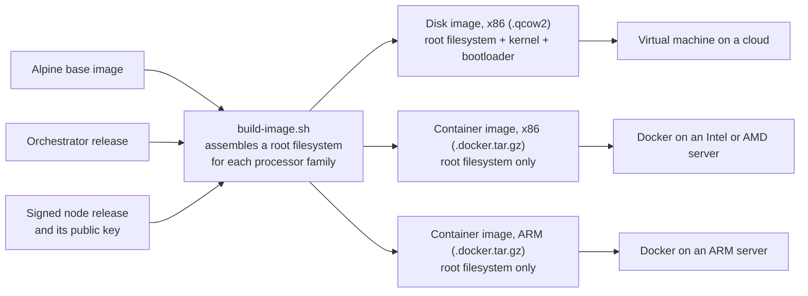

# One build, three images

Every run of [image/build-image.sh](../image/build-image.sh) writes three files
into `dist/image/`. They are built together, from the same commit, and hold
the same orchestrator, firewall rules and node release. The wrapping
differs, and so does the processor they are built for.

| | Disk image | Container image, x86 | Container image, ARM |
| --- | --- | --- | --- |
| File | `fortis-node-os-x86_64-COMMIT.qcow2` | `fortis-node-os-x86_64-COMMIT.docker.tar.gz` | `fortis-node-os-aarch64-COMMIT.docker.tar.gz` |
| Used for | A new virtual machine on a cloud (a DigitalOcean Droplet, for example). The main way to run a node | A server that already runs Docker, with an Intel or AMD processor | A server that already runs Docker, with an ARM processor |
| How it is started | The cloud boots it | `docker load`, then `docker run` | `docker load`, then `docker run` |
| Size | About 72 MB | About 14 MB | About 14 MB |
| Contains a kernel | Yes | No | No |

**Why one image per processor.** A program is a list of instructions for
one family of processors. Intel and AMD processors understand one set of
instructions (called x86_64); ARM processors, found in many cheaper cloud
servers and in Apple's computers, understand another (aarch64). The
orchestrator and the node are compiled once for each, and an image holds the
pair that matches. A host refuses a node release built for the other family
instead of trying to run it.



### Why a disk and a container, and why Docker cannot run the disk image

It helps to know what each kind of image really is.

**A disk image is a whole computer's hard disk in one file.** A `.qcow2`
file is a copy of a disk, byte for byte: a partition table, a bootloader, an
operating system kernel, and then all the files. A virtual machine is a
pretend computer. When it is switched on it does what a real computer does:
it reads the start of the disk, runs the bootloader, the bootloader loads
the kernel, and the kernel starts everything else. The machine has its own
kernel and shares nothing with its neighbours.

**A container image is only a folder of files.** It has no bootloader and no
kernel. A container is not a pretend computer. It is an ordinary program
running on the server's own kernel, which shows that program a different
folder as its `/` and hides the server's other programs from it. Starting a
container means "run this one program, with this folder as its world". Nothing
boots.

So the two do not fit each other:

- **Docker cannot run a disk image**, because Docker never boots anything.
  It has no pretend computer to read a partition table or run a bootloader,
  and it has no use for a second kernel: the server's kernel is already
  running. Handing Docker a `.qcow2` is like handing a DVD player a whole
  second DVD player and asking it to play it.
- **A cloud cannot boot a container image**, because there is nothing in it
  to boot: no bootloader and no kernel.

There is one way around this: run a program inside Docker that *is* a
pretend computer (an emulator such as QEMU) and let that boot the disk image.
It works and it is useful for testing, but it is slow, and it is a virtual
machine wearing a container as a coat, not a container.

That is why the build writes both. It assembles the files once, then saves
them twice: once as a disk with a kernel and bootloader in front, and once as
a plain folder with `/boot` and the kernel modules left out.

### What differs when they run

The orchestrator and the node are the same program files in both. What
changes is who does the jobs around them:

| Job | Disk image (a machine) | Container image |
| --- | --- | --- |
| Starting the orchestrator, restarting it | The service `fortis-native` ([image/files/fortis-native.openrc](../image/files/fortis-native.openrc)) | [image/files/container-start.sh](../image/files/container-start.sh) and Docker's restart policy |
| Network address, SSH key, disk size | `tiny-cloud`, from the cloud's metadata | Docker and the server |
| Firewall | `nftables` inside the image: only ports 22, 80 and 443 | Only the ports published with `-p`; the server's own firewall |
| Clock | `chronyd` inside the image | The server's clock |
| Public address | Read from the network interface when it is public | Not visible from inside a container, so the host asks for it (see below) |
| Settings | User data starting with `#fortis-settings` | `-e FORTIS_...=...` variables |
| Where the data lives | The machine's disk, `/var/lib/fortis` | A Docker volume mounted at `/var/lib/fortis` |
| Logging in | SSH as `alpine`, then `doas fortis status` | `docker exec fortis-node fortis status` |
| The orchestrator's log | `/var/log/fortis-orchestrator.log` | `docker logs fortis-node` |
| Isolation | Its own kernel: the strongest kind | Shares the server's kernel and holds the `SYS_ADMIN` right inside its container (not `--privileged`): weaker than a machine of its own |

Choose the disk image when you can give the node a machine of its own. Choose
the container image when the server already exists and runs other things.

### How the orchestrator knows which one it is in

Nobody tells it. At start it looks for the marks a container runtime leaves
behind (the file `/.dockerenv`, the file `/run/.containerenv`, or a variable
named `container` given to the first process). If it finds one it is in a
container; otherwise it is on a machine. The check is `HostKind` in
[orchestrator/first_boot.cpp](../orchestrator/first_boot.cpp). It then says so in
three places:

| Where | What you see |
| --- | --- |
| Its log | `Orchestrator supervising; runs in: container` or `runs in: machine` |
| `https://ADDRESS/health.json` | `"orchestrator": {"runsIn": "container", ...}` |
| The health page | "Supervising this host. It runs in a container." |

Running the container image, option by option, is described in
[image/README.md](../image/README.md#the-container-packaging).

### Trying a container image on your own computer

[image/test-container.sh](../image/test-container.sh) starts a container image
beside a stand-in certificate authority and checks the whole path: first
boot, the certificate, the install of the node, the node answering over
HTTPS under its system call filter.

```sh
./image/test-container.sh fortis-node-os:COMMIT-aarch64          # on an ARM computer
./image/test-container.sh fortis-node-os:COMMIT-x86_64 --keep    # on an Intel or AMD one; leave it running
```

It only runs the image built for the computer's own processor. Docker can
run programs of the other family by translating them, but the program that
puts the node in its container (`crun`) does not survive that translation.
