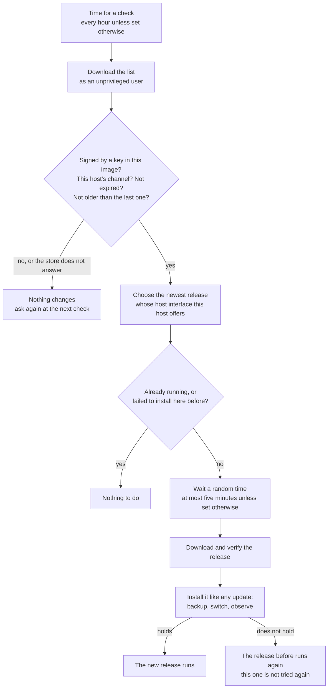

# Node releases: publishing, fetching and automatic updates

Node releases reach a host from a **release store**: plain files served over
HTTPS. The store is not trusted. Only signatures are, checked against the
public keys installed on the host. Where a file came from never matters;
who signed it does.

A host with a store installs the newest release it can run **by itself**: on
its first start, and from then on whenever a newer one is published. A host
without a store installs the release that came with its image and afterwards
only what an operator gives it. **No store is set by default**; see
[Settings](#settings) for how to name one.

## What a store holds

A store has a **release list** (also called the index) and, for every
release on it, three files: the program `fortis-node`, its `manifest` and
the manifest's signature. There are two ways to lay these out.

**As a tree**, for any object store or static file host that honours range
requests. Set `FORTIS_NATIVE_RELEASE_STORE=https://host/path`:

```
STORE/ARCH/index                         the release list
STORE/ARCH/index.sig                     signature over the exact list bytes
STORE/ARCH/releases/VERSION/manifest     as written by the node's release build
STORE/ARCH/releases/VERSION/manifest.sig
STORE/ARCH/releases/VERSION/fortis-node
```

**Flat**, for the downloads of GitHub releases, where a folder is one
release and cannot hold another folder. Set
`FORTIS_NATIVE_RELEASE_STORE=flat:https://host/prefix`:

```
PREFIX/node-channel-CHANNEL/index-ARCH
PREFIX/node-channel-CHANNEL/index-ARCH.sig
PREFIX/node-V/fortis-node-ARCH
PREFIX/node-V/fortis-node-ARCH.manifest
PREFIX/node-V/fortis-node-ARCH.manifest.sig
```

`V` is the version without a leading `node-`, so the versions
`node-9ed7c09016ee` and `1.2.3` live under `node-9ed7c09016ee` and
`node-1.2.3`. `FORTIS_NATIVE_RELEASE_STORE=github:OWNER/REPO` is short for
`flat:https://github.com/OWNER/REPO/releases/download`: on GitHub, the list
is then the files of a release tagged `node-channel-stable`, and each node
release is a release tagged `node-V`.

`ARCH` is the processor architecture, `x86_64` or `aarch64`. A release is
built and signed once for each, under the same version, and each
architecture has its own list. A host reads only the files of its own
architecture, and refuses a release built for the other one.

A store may answer a request with a redirect to another HTTPS address;
GitHub does so for every download. A host follows up to five redirects for
one file, to `https` addresses only, with the same size limits as before.
The program is downloaded in pieces, and each piece is asked for afresh.

## The release list

```
format=2
sequence=7
published_ms=1764000000000
expires_ms=1766592000000
channel=stable
release<TAB>VERSION<TAB>MANIFEST_SHA256<TAB>EXECUTABLE_BYTES<TAB>HOST_INTERFACE
```

One `release` line for each release, oldest first; the last line is the
newest. The header lines come in exactly this order.

| Line | Meaning |
| --- | --- |
| `sequence` | Grows by one with every publication. A host never accepts a list with a lower number than one it has accepted, nor a different list under the same number |
| `published_ms` | When the list was signed, in milliseconds since 1970 |
| `expires_ms` | From this moment on, hosts refuse the list. Whoever controls the store could otherwise serve one old, validly signed list for ever and so hide every later release. Publish again before a list expires, even when there is no new release |
| `channel` | Which hosts the list is for: `stable` or `edge`. A host follows one channel (`FORTIS_NATIVE_CHANNEL`, `stable` unless set) and refuses a list for another |
| `HOST_INTERFACE` | What the release needs from the host it runs on; see [Which releases a host can run](#which-releases-a-host-can-run) |

**Having exactly two channels, `stable` and `edge`, is provisional.** Their
names, their number and what each one promises are not settled and are
expected to change.

Hosts still accept the older **format 1**: the first three header lines and
`release` lines without the last field. Such a list never expires, names no
channel, and every release on it is taken to need host interface 1.

## Which releases a host can run

A node release needs things from its host: how its listening sockets are
handed over, where its certificates and its pages are, and so on. Together
these are the **host interface**, and it has a number.

- A release's manifest may say `host_interface=N`: the one number it was
  built against. A manifest that does not say means 1.
- The orchestrator offers a range of numbers, today 1 to 1. It refuses a
  release outside the range before anything of it runs, however the release
  arrived, with a message such as *"this release needs host interface 2;
  this Node OS offers 1 to 1"*.
- The number goes up only when the node needs something new from its host.
  An orchestrator that learns a new number keeps offering the previous one.

So a newer Node OS always runs the releases the one before it ran, and an
older Node OS simply does not take a release it cannot serve: it stays on
the newest one it can run and says which newer ones it skipped, and why.
The list carries the number of every release, so a host chooses without
downloading anything.

## Automatic updates

With a store set, the supervisor does this by itself while the node runs:



- **The newest it can run.** The last release on the list whose host
  interface this host offers. Newer ones it cannot run are skipped and
  named on its pages.
- **A random wait.** Between finding a release and installing it, a host
  waits a random time, so that the hosts of a network do not all download
  and restart in the same minute. The time is chosen once and kept across
  restarts. When it has come, the list is asked for once more, so a release
  that was withdrawn meanwhile is not installed.
- **The same care as any update.** The download is verified as below, then
  installed by the same steps as `fortis update`: backup, switch, observe,
  and back to the release before if the new one does not hold.
- **A failed install is not repeated.** A release whose install was started
  and did not complete is not tried again automatically, whatever the
  reason was. An operator can still install it with `fortis fetch` and
  `fortis update`. The next release published is installed as usual.
- **An unreachable store changes nothing.** The running node is not
  touched, the host is not reported unhealthy because of it, and the store
  is asked again at the next check.
- **Only while the node runs.** An install is never what starts a node that
  is stopped.
- **On first start** a new host asks the store before it installs the
  release in its image, and installs the newest release at once, without
  the random wait. If the store does not answer within about a minute, or
  has nothing newer that the host can run, the release in the image is
  installed as before and the regular checks take over.

A host that should stay on the release an operator chose needs
`FORTIS_NATIVE_AUTO_UPDATE=0`: otherwise the next check moves it to the
newest release again.

### What the host shows

The first page and the health page say in a sentence what the host is doing
about releases: looking, found one and when it will be installed,
downloading, verifying, installing, or which newer release it skipped and
why. `/node.json` says the same for tools:

```json
{
  "schemaVersion": 1,
  "generatedMs": 1764000300000,
  "running": {"version": "1.2.3", "sha256": "…", "hostInterface": 1, "sinceMs": 1764000000000},
  "host": {"nodeOsVersion": "0.1.0", "architecture": "x86_64", "runsIn": "machine",
           "hostInterfaceMin": 1, "hostInterfaceMax": 1, "channel": "stable",
           "automaticUpdates": true, "store": "github:OWNER/REPO"},
  "update": {"state": "waiting",
             "candidate": {"version": "1.2.4", "hostInterface": 1, "bytes": 61234567},
             "installInSeconds": 140, "downloadedBytes": null,
             "lastCheckMs": 1764000290000, "nextCheckMs": 1764000440000,
             "message": "Found release 1.2.4. It will be installed in about 2 minutes."},
  "skipped": [{"version": "2.0.0", "reason": "needs host interface 2; this Node OS offers 1 to 1"}],
  "history": [{"version": "1.2.3", "sha256": "…", "result": "installed", "reason": "none", "atMs": 1764000000000}]
}
```

| Field | Meaning |
| --- | --- |
| `running` | The installed release, or `null` when none is. `sinceMs` is when its process started, `null` while it is stopped for a moment |
| `host` | This Node OS: its version, the host interfaces it offers, the channel it follows, whether it updates by itself, and the store as it was configured (`null` when none is) |
| `update.state` | `off` (no store, or automatic updates switched off), `idle`, `looking`, `waiting`, `downloading`, `verifying`, `installing` or `failed` (the last check or install did not succeed; `message` says which and why) |
| `update.candidate` | The release chosen to be installed next, or `null` |
| `update.installInSeconds` | While `waiting`: seconds until the install. Otherwise `null` |
| `update.downloadedBytes` | While `downloading`: how much has arrived. Otherwise `null` |
| `update.lastCheckMs`, `nextCheckMs` | When the store last gave an acceptable list, and when it is asked next |
| `skipped` | Newer releases that were not taken, newest first, each with the reason |
| `history` | The last few installs (`installed`), rollbacks (`rolled-back`) and refusals (`refused`), newest first |

`/node.json` always answers 200 and is not a health report: a newer release
or an unreachable store does not make a host unhealthy. While no node runs
the page server serves it; a node serves it once it knows the file (see
[development.md](development.md#the-contract-with-the-node)).

## By hand

The operator's commands work with or without automatic updates:

```sh
fortis releases          # check the store, list what it offers
fortis fetch VERSION     # download and stage one release
fortis update VERSION    # install a staged release
```

`fetch` only stages; the operator decides when to run `update`, which then
does what an update always does: preflight, backup, switch, observe, and
roll back on failure.

## What is checked, and by whom

- **The part that talks to the network installs nothing.** Lists and
  releases are downloaded by an unprivileged process that gives up
  administrator rights first and can only write its own staging folder.
- **The administrator side verifies everything it was handed:** the list's
  signature; that the list is for this host's channel and has not expired;
  that it is not older than one already accepted, and not a different list
  under the same sequence; that the downloaded manifest is the one the list
  names; then the release's own signature, hash, size, architecture, storage
  format and host interface, on a private copy that cannot be swapped
  afterwards. Anything that fails is discarded and the running node is not
  touched.
- **Two keys.** A release or list may be signed by the release key or, when
  `FORTIS_NATIVE_RECOVERY_KEY` is set, by an offline recovery key, so a lost
  release key can be replaced without reinstalling hosts.

## Publishing

On the signing machine, [tools/publish_release.py](../tools/publish_release.py)
adds a signed release to a local copy of the store and re-signs the list
with the next sequence number; the folder is then uploaded as it is.

```sh
tools/publish_release.py STORE_FOLDER RELEASE_FOLDER PRIVATE_KEY
tools/publish_release.py --layout flat --channel edge --expires-days 14 STORE_FOLDER RELEASE_FOLDER PRIVATE_KEY
```

| Option | Meaning |
| --- | --- |
| `--layout tree` or `flat` | Which of the two layouts to write. `tree` unless given. With `flat`, each folder written is one GitHub release, named by its tag, and its files are that release's assets |
| `--channel stable` or `edge` | The channel the list is for. `stable` unless given. In the flat layout each channel has a folder and a list of its own |
| `--expires-days N` | How long hosts accept the list. 30 unless given |
| `--format 1` | Write the older list format |

The host interface of each release is read from its manifest. Never restore
an old copy of the store folder and publish from it: the sequence would
repeat, and hosts would refuse the list.

## Settings

All are in `/etc/fortis/orchestrator.conf`. On a new machine they can be
given at creation ([image/README.md](../image/README.md#settings-at-creation-when-wanted)).

| Setting | Meaning | Unless set |
| --- | --- | --- |
| `FORTIS_NATIVE_RELEASE_STORE` | The store: `https://host/path`, `flat:https://host/prefix` or `github:OWNER/REPO` | No store: nothing is fetched |
| `FORTIS_NATIVE_CHANNEL` | The channel to follow: `stable` or `edge` | `stable` |
| `FORTIS_NATIVE_AUTO_UPDATE` | `1`: install the newest release the host can run by itself. `0`: only what the operator installs | `1` |
| `FORTIS_NATIVE_UPDATE_CHECK_SECONDS` | How often the store is asked, 30 to 86400 | `3600` |
| `FORTIS_NATIVE_UPDATE_DELAY_SECONDS` | The longest random wait before an install, 0 to 3600 | `300` |
| `FORTIS_NATIVE_FETCH_STATE`, `FORTIS_NATIVE_FETCH_USER` | The folder and the user of the unprivileged process | `/var/lib/fortis-fetch` (a host made from an image is given `/var/lib/fortis/fetch`), `10004` |
| `FORTIS_NATIVE_RECOVERY_KEY` | A second public key that may sign lists and releases | None |

One gap remains with a format 1 list, which never expires: whoever controls
the store can keep serving an old, validly signed one and so hide newer
releases. The date of the last accepted list is on the health page.
