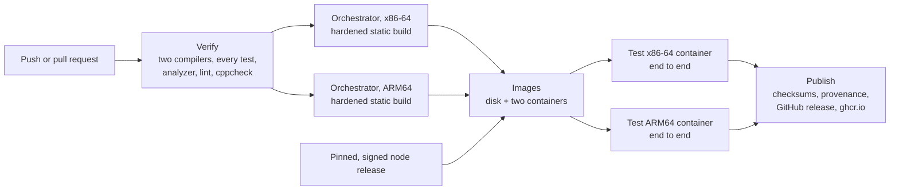

# Builds, releases and downloads

Everything people download is built by GitHub Actions from this repository
([.github/workflows/build.yml](../.github/workflows/build.yml)). Nothing is
built on a maintainer's computer and uploaded by hand.

## What runs when

| Event | Verify | Build and test | Published as |
| --- | --- | --- | --- |
| Pull request | yes | yes | nothing |
| Push to `main` | yes | yes | the rolling pre-release **edge**, replaced by every push |
| Tag `vX.Y.Z` | yes | yes | release **vX.Y.Z** |



1. **Verify.** `make verify`: Clang and GCC builds, every test with both,
   the Clang Static Analyzer, clang-tidy, clang-format and cppcheck.
2. **Orchestrator.** A hardened static release for each processor family,
   each built on a runner of that family. The gate runs again there first: a
   release is only built from files with a passing report.
3. **Images.** The disk image and the two container images, from those
   releases and the pinned node release.
4. **Test.** Each container image is started on a runner of its own
   processor family, beside a stand-in certificate authority, and must reach
   "node serving over HTTPS under its system call filter".
5. **Publish.** Only for pushes, and only when everything above passed.

## What is published

| Where | What |
| --- | --- |
| [Releases](https://github.com/FortisNet/node-os/releases) | The disk image, both container images as files, the orchestrator alone for each processor family, the package list of each image, and `SHA256SUMS` |
| `ghcr.io/fortisnet/node-os` | The container images under one name. Docker picks the right processor family. Tags: `edge`, `vX.Y.Z`, `latest` (newest release) and the 12-character commit |

```sh
docker pull ghcr.io/fortisnet/node-os:edge
```

## Checking a download

Every file comes with two proofs.

**It arrived intact.** `SHA256SUMS` lists the hash of every file:

```sh
sha256sum -c SHA256SUMS --ignore-missing
```

**It was built here, from this source.** Each file and the container image
have a signed build provenance statement: GitHub records which repository,
commit and workflow produced them. With the [GitHub CLI](https://cli.github.com):

```sh
gh attestation verify fortis-node-os-x86_64-COMMIT.qcow2 --repo FortisNet/node-os
gh attestation verify oci://ghcr.io/fortisnet/node-os:edge --repo FortisNet/node-os
```

Every image also says what it is, inside: `/etc/fortis-image` holds the
commit, the orchestrator's version and hash, the node release and its hash,
and the hash of the release key it trusts.

## The node release inside the images

An image carries one release of the FortisNet node and the public key that
node releases must be signed with. Both are pinned in the repository, so
changing either is a reviewed change:

| File | What it is |
| --- | --- |
| `image/release-public.pem` | The public half of the release key. A host made from an image trusts this key, and no other, for its whole life |
| `image/node-release.conf` | The release store's address, the version, and the SHA-256 of each architecture's manifest |

[image/fetch-node-release.sh](../image/fetch-node-release.sh) downloads the
release and keeps it only when the manifest is the pinned one, is signed by
the key, and names the program that was downloaded.

**Until both files exist, the pipeline builds and publishes the orchestrator
only**, and says so in the release notes.

The private half of the release key is never given to GitHub. Node releases
are signed on a separate, trusted computer and uploaded to the store already
signed; this pipeline only checks signatures.

To put a new node release into the images:

1. Build and sign it for both architectures, and publish it to the store
   with [tools/publish_release.py](../tools/publish_release.py).
2. Set `version` and the two `manifest_sha256_...` values in
   `image/node-release.conf` (`sha256sum manifest` for each architecture).
3. Open a pull request. The pipeline fetches, verifies, builds and tests
   with it.

## Making a release

1. Make sure `main` is green.
2. Tag the commit and push the tag:

   ```sh
   git tag -s v1.2.3 -m "v1.2.3"
   git push origin v1.2.3
   ```

3. The pipeline builds everything again from that tag and creates the
   release with generated notes. Edit the notes to say what changed for
   someone running a node.

Version numbers follow [Semantic Versioning](https://semver.org). A release
is never replaced: if something is wrong with it, publish the next one.

## How the pipeline is kept safe

- **Actions are pinned to commits**, not to tags that can move.
  [Dependabot](../.github/dependabot.yml) proposes updates as pull requests.
- **Least privilege.** Every job can only read the repository, except the
  publishing job, which may create a release, push to `ghcr.io` and sign
  provenance. Pull requests never reach that job.
- **No long-lived secrets.** The pipeline uses only the token GitHub issues
  for the run. There is no signing key or registry password to steal.
- **The gate has no network.** Tests and analysis run in a container with
  the network switched off.
