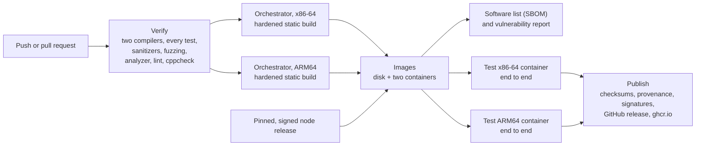
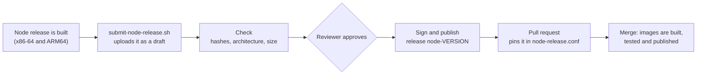

# Builds, releases and downloads

Everything people download is built by GitHub Actions from this repository
([.github/workflows/build.yml](../.github/workflows/build.yml)). Nothing is
built on a maintainer's computer and uploaded by hand.

## What runs when

| Event | Verify | Build and test | Published as |
| --- | --- | --- | --- |
| Pull request | yes | yes | nothing |
| Push to `main` | yes | yes | the rolling pre-release **edge**, replaced by every push |
| Tag `vX.Y.Z` | yes | yes | release **vX.Y.Z** |



1. **Verify.** `make verify`: Clang and GCC builds, every test with both
   and again under sanitizers, a minute of fuzzing, the Clang Static
   Analyzer, clang-tidy, clang-format, cppcheck and pyflakes.
2. **Orchestrator.** A hardened static release for each processor family,
   each built on a runner of that family. The gate runs again there first: a
   release is only built from files with a passing report.
3. **Images.** The disk image and the two container images, from those
   releases, the pinned node release and the pinned Alpine packages
   (`image/packages.*.lock`). Then a list of the software in each (an SBOM,
   in SPDX format) and a report of known vulnerabilities in it.
4. **Test.** Each container image is started on a runner of its own
   processor family, beside a stand-in certificate authority, and must reach
   "node serving over HTTPS under its system call filter".
5. **Publish.** Only for pushes, and only when everything above passed.

## What is published

| Where | What |
| --- | --- |
| [Releases](https://github.com/FortisNet/node-os/releases) | The disk image, both container images as files, the orchestrator alone for each processor family, the package list and the SBOM (`.spdx.json`) of each image, `SHA256SUMS` and its signature |
| `ghcr.io/fortisnet/node-os` | The container images under one name. Docker picks the right processor family. Tags: `edge`, `vX.Y.Z`, `latest` (newest release) and the 12-character commit |

```sh
docker pull ghcr.io/fortisnet/node-os:edge
```

## Checking a download

Every file comes with these proofs.

**It arrived intact.** `SHA256SUMS` lists the hash of every file:

```sh
sha256sum -c SHA256SUMS --ignore-missing
```

**It was built here, from this source.** Each file and the container image
have a signed build provenance statement: GitHub records which repository,
commit and workflow produced them. With the [GitHub CLI](https://cli.github.com):

```sh
gh attestation verify fortis-node-os-x86_64-COMMIT.qcow2 --repo FortisNet/node-os
gh attestation verify oci://ghcr.io/fortisnet/node-os:edge --repo FortisNet/node-os
```

**The same, without GitHub's tools.** `SHA256SUMS` and the container images
are also signed with [cosign](https://docs.sigstore.dev/cosign/system_config/installation/).
There is no key to keep or to trust: the signature's certificate names the
workflow that made it.

```sh
identity='^https://github.com/FortisNet/node-os/\.github/workflows/build\.yml@refs/(heads/main|tags/v.*)$'
issuer=https://token.actions.githubusercontent.com
cosign verify-blob SHA256SUMS --bundle SHA256SUMS.sigstore.json \
  --certificate-identity-regexp "$identity" --certificate-oidc-issuer "$issuer"
cosign verify ghcr.io/fortisnet/node-os:edge \
  --certificate-identity-regexp "$identity" --certificate-oidc-issuer "$issuer"
```

**What is inside.** `fortis-node-os-ARCH-COMMIT.spdx.json` lists every Alpine
package in the images of that processor family, with its version and
license. The orchestrator, the node and Mbed TLS are static programs that a
package scanner does not see; `/etc/fortis-image` names their versions and
hashes.

## Known vulnerabilities

Every build reports the known vulnerabilities in its images, on the run's
summary page. The report does not stop a build: a vulnerability is published
on its own day, not by a commit.

[scan.yml](../.github/workflows/scan.yml) therefore scans the published
`edge` and `latest` images every week. It fails when a package has a high or
critical vulnerability that Alpine has already fixed. The answer is to
update the package lock (`FORTIS_UPDATE_PACKAGE_LOCK=1`, see
[development.md](development.md#building-the-images)) and publish new
images. Findings are listed under **Security**, **Code scanning**, together
with those of [CodeQL](../.github/workflows/codeql.yml) and the
[OpenSSF Scorecard](https://scorecard.dev/viewer/?uri=github.com/FortisNet/node-os).

Every image also says what it is, inside: `/etc/fortis-image` holds the
commit, the orchestrator's version and hash, the node release and its hash,
and the hash of the release key it trusts.

## The node release inside the images

An image carries one release of the FortisNet node and the public key that
node releases must be signed with. Both are pinned in the repository, so
changing either is a reviewed change:

| File | What it is |
| --- | --- |
| `image/release-public.pem` | The public half of the release key. A host made from an image trusts this key, and no other, for its whole life |
| `image/node-release.conf` | Where the node release is, its version, and the SHA-256 of each architecture's manifest |

The node release itself is published as a release of this repository named
`node-VERSION` (a version that already starts with `node-` is not given the
prefix twice), holding the program, its manifest and the manifest's
signature for each architecture.
[image/fetch-node-release.sh](../image/fetch-node-release.sh) downloads them
and keeps them only when each manifest is the pinned one, is signed by the
key, and names the program that was downloaded.

**Until both files exist, the pipeline builds and publishes the orchestrator
only**, and says so in the release notes.

### Who signs, and where the key is

Node releases are signed by GitHub Actions, in the workflow
[sign-node-release.yml](../.github/workflows/sign-node-release.yml). The
private half of the release key is the secret `RELEASE_SIGNING_KEY` of the
environment `release-signing`, and that environment requires a reviewer's
approval before any job may use it.

| Protection | What it does |
| --- | --- |
| Approval for every signing | A person sees what is about to be signed (version, program hashes, source commit) and presses Approve. Nothing is signed without that |
| A job that only signs | The job holding the key signs two small text files that an earlier job already checked. It runs no code from the release or the repository |
| The key must match | Signing refuses a key that is not the one of `image/release-public.pem` |
| Never signed twice | Only a draft can be signed. A published node release is never changed |
| A second key, offline | The orchestrator also accepts a recovery key (`FORTIS_NATIVE_RECOVERY_KEY`). Keeping one offline is the way back if this key is ever exposed |

Set the environment's **deployment branches** to `main` only, so the key
cannot be reached from another branch. A host trusts the key in its image
for its whole life: replacing the key means new images.

### Setting the key up, once

On a trusted computer, outside any repository:

```sh
openssl genpkey -algorithm EC -pkeyopt ec_paramgen_curve:P-256 -out release-private.pem
openssl pkey -in release-private.pem -pubout -out release-public.pem
gh secret set RELEASE_SIGNING_KEY --env release-signing --repo FortisNet/node-os < release-private.pem
```

Create the environment `release-signing` first (Settings, Environments),
with required reviewers. Commit `release-public.pem` as
`image/release-public.pem`. Then move `release-private.pem` to offline
storage and remove it from the computer.

### Putting a node release into the images



1. Build the node release for both architectures in the node's repository.
2. Hand it over:

   ```sh
   ./tools/submit-node-release.sh PATH/TO/native-releases/VERSION
   ```

3. Open the run of **Sign node release** on the Actions page, read the
   summary, and approve.
4. Merge the pull request it opens. The build that follows puts this node
   release into the three images and publishes them.

## Making a release

1. Make sure `main` is green.
2. In [CHANGELOG.md](../CHANGELOG.md), give the release its date and say what
   changed for someone running a node. Merge that.
3. Tag the commit and push the tag:

   ```sh
   git tag -s v1.2.3 -m "v1.2.3"
   git push origin v1.2.3
   ```

4. The pipeline builds everything again from that tag and creates the
   release with generated notes.

Version numbers follow [Semantic Versioning](https://semver.org). A release
is never replaced: if something is wrong with it, publish the next one.

## How the pipeline is kept safe

- **Actions are pinned to commits**, not to tags that can move.
  [Dependabot](../.github/dependabot.yml) proposes updates as pull requests.
- **Least privilege.** Every job can only read the repository, except the
  publishing job, which may create a release, push to `ghcr.io` and sign
  provenance. Pull requests never reach that job.
- **No long-lived secrets in the build.** The build pipeline uses only the
  token GitHub issues for the run: there is no registry password, and the
  cosign signatures need no key. The one long-lived secret, the node release
  key, is reachable only by the signing workflow, after an approval.
- **The gate has no network.** Tests and analysis run in a container with
  the network switched off.
